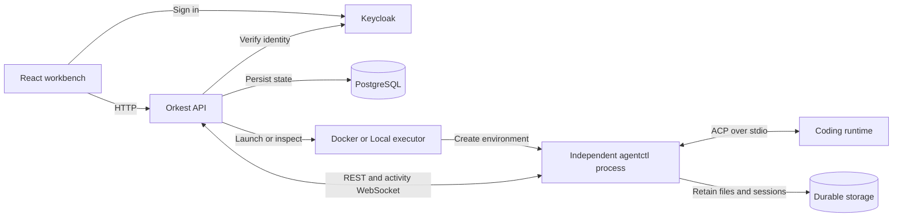
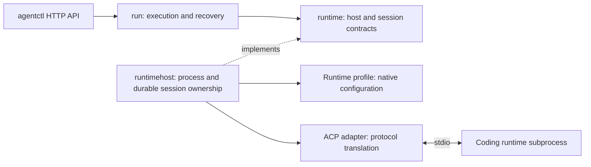

# Architecture and extension points

Go platform, independent `agentctl` worker, React UI. These boundaries describe
current code; refactoring rules may not yet hold in every package.

## Design approach

- Struct methods group state/behavior; small interfaces support interchangeable dependencies.
- Explicit constructors keep dependencies visible; consumers own interfaces.
- Services own business rules/authorization; handlers decode/call/encode.
- Repository adapters load facts/persist transactional decisions; provider adapters translate external behavior.
- App wiring selects dependencies/manages lifecycle.
- Keep SQL-generated/SDK types inside adapters. Avoid base classes, service locators,
  and forwarding-only interfaces; every interface needs a boundary/consumer purpose.
- Use domain names/focused functions. Comment unexplained invariants, ownership, locks, recovery.

## System boundary

- `cmd/orkest` → `bin/orkest`: embedded Goose migrations, optional `web/dist` serving.
- `cmd/agentctl` → `bin/agentctl`: independent worker.
- SQL inputs: `db/migrations`, `db/queries`; generated persistence types stay in adapters.
- Web client/validators: generated from platform OpenAPI.

## Platform ownership

Arrows below show calls or implemented contracts, not a complete import graph.

| Area | Owns |
| --- | --- |
| `cmd/orkest`, `internal/app` | Platform startup, dependency selection, shutdown |
| `internal/app/httpapi` | Platform routes, wire types, OpenAPI contract |
| `internal/identity`, `organization`, `workspace` | Identity, memberships, workspace access |
| `internal/task` | Task content, CRUD, task-owned repository and workflow contracts |
| `internal/workflow` | Board, stage, and rule configuration |
| `internal/workflowautomation` | Stage transitions, rule evaluation, start delivery |
| `internal/orchestration` | Dispatch, run/session identity, launch and reconnect |
| `internal/artifact` | Task outputs, immutable revisions, publication checks |
| `internal/postgres` | Persistence adapters and transaction boundaries |
| `internal/executors` | Docker or Local environment selection and lifecycle |
| `web/` | UI, scoped query caches, generated platform API client |

`TaskService` receives `TaskRepository`/`TaskWorkflowPlanner` through its constructor,
requesting movement without importing automation. PostgreSQL commits results/events
together. See [workflows](guides/workflows.md).

## Worker ownership

- `config`: settings; `interaction`: commands/approvals/events; `run`: queue/journal/recovery.
- `runtimehost`: subprocesses/manifests/locks; profiles: native configuration; ACP: translation.
- Concrete runtimes exclude platform/run dependencies.
- Contracts/locking: [agentctl development](development/agentctl.md).

## Add an implementation

| Change | Extension point | Keep outside core policy |
| --- | --- | --- |
| New executor | `orchestration.ProcessExecutor` and `AgentProcessController`; select in `executors` | Process/container API details |
| New runtime | `runtime.RuntimeProfile`, protocol factory, optional host preparation strategy | Native configuration and protocol types |
| New task source | `taskintegration` provider contract and typed config schema | Source API calls and field mapping |
| New coding provider | `coderepository.CodingProvider` | Authentication, discovery, checkout details |
| New persistence adapter | Consumer-owned repository contracts | Database rows and query code |

Extensions need wiring, validation, docs, behavior tests. Runtimes also need saved-session
compatibility and credentialed qualification before claiming verified live behavior.

## Preserve during refactoring

- Authorize every operation by organization/workspace; Viewers read only.
- Separate workflow position from run health.
- Preserve run/command IDs, event order, working paths, durable configuration.
  Existing sessions retain compatible runtime/model/permissions.
- Compatibility changes require restore plus follow-up testing; loading alone proves no continuation.
- Shutdown leaves workers running; disconnection neither proves termination nor permits replacement.
- Reconcile uncertain effects before retry; recovery never auto-answers approvals.

See [unfinished work](status.md) and [verification](development/testing.md).
