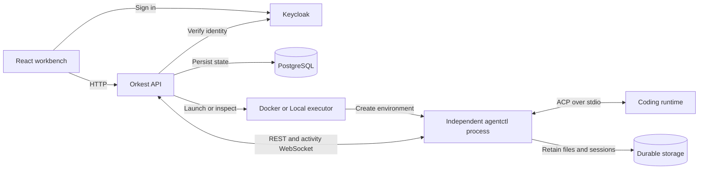
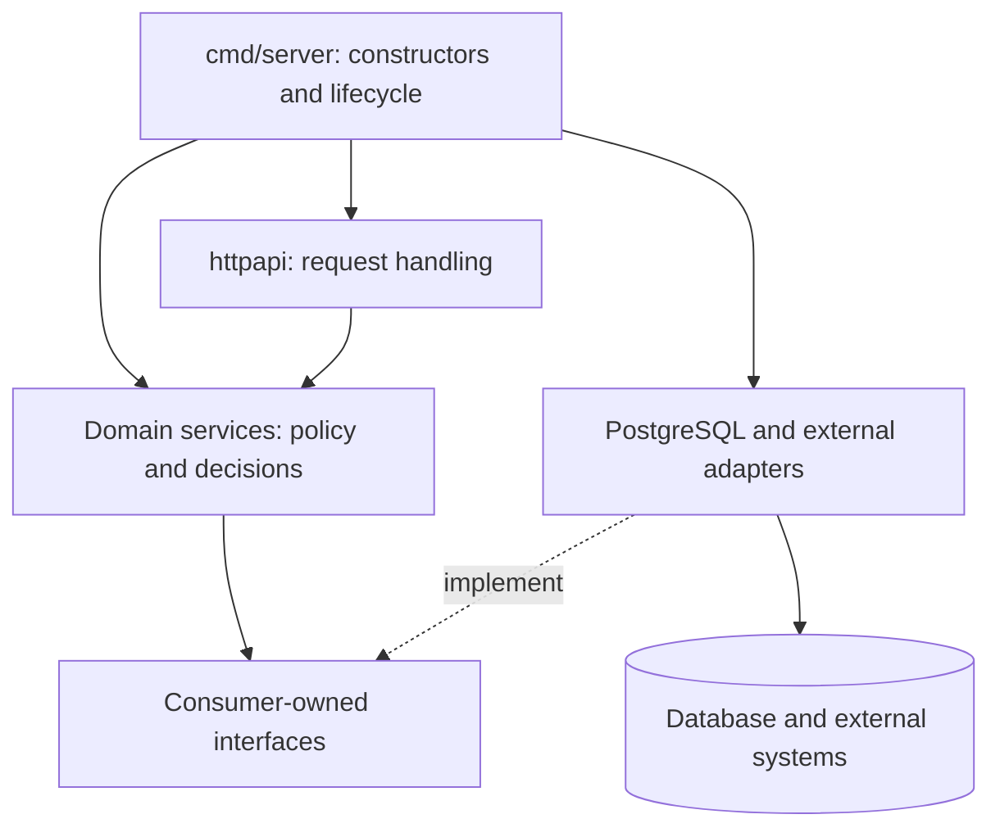
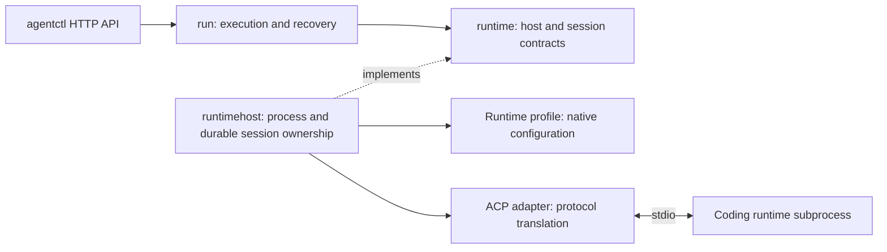

# Architecture and extension points

See the domain-specific [architecture flow diagrams](architecture/flows/README.md)
for task/workflow, execution/recovery, agentctl, artifact, scheduled-job, and
integration flows.

Go platform, independent `agentctl` worker, React UI. These boundaries describe
current code and are enforced by `make check-runtime-boundaries`.

## Design approach

- Struct methods group state/behavior; small interfaces support interchangeable dependencies.
- Explicit constructors keep dependencies visible; consumers own interfaces.
- Services own business rules/authorization; handlers decode/call/encode.
- Repository adapters load facts/persist transactional decisions; provider adapters translate external behavior.
- Command wiring selects dependencies/manages lifecycle before requests are served.
- Keep SQL-generated/SDK types inside adapters. Avoid base classes, service locators,
  and forwarding-only interfaces; every interface needs a boundary/consumer purpose.
- Use domain names/focused functions. Comment unexplained invariants, ownership, locks, recovery.

## File and model organization

Files group cohesive responsibilities rather than individual declarations. Related
entities, inputs, enums, and value types may share a file. Public domain data lives
in leaf `model` subpackages; services, consumer-owned interfaces, and policies stay
in the parent. Models may reference other models within the same server/worker
boundary, shared contracts, and technical utilities, but never domain services,
their parent package, or concrete adapters. Architecture checks enforce this rule.

For example, `task/model` groups task/repository values, comments, and execution
inputs in three files. `orchestration/model` groups configuration, launches/status,
activity, and interactions. `agentctl/config/model` owns worker configuration and
validation; `agentctl/run/model` owns public execution status. Callers import those
packages directly, using aliases such as `taskmodel` when several models meet.
There are no forwarding aliases in service packages.

Private conversation state, checkpoint records, synchronization details, and
transaction snapshots/effects remain beside their owning implementation or policy.
Small runtime contracts remain grouped by boundary. HTTP adapters group private
request/view DTOs by resource, and versioned wire DTOs remain in their existing
contract package. Generated sqlc files remain generator-owned.

Shared scalar configuration checks live in `internal/contracts/configvalidation`;
each domain retains its own models and validation errors. Local and Docker
executors share checkout preparation through `internal/adapters/executors/checkout`
while preserving their existing directory layouts and lifecycle ownership. Technical
slice mapping preserves nil versus empty slices; string deduplication is separate
from validation that rejects duplicate IDs.

## System boundary

- `cmd/server` → `bin/orkest`: embedded Goose migrations, optional `web/dist` serving.
- `cmd/agentctl` → `bin/agentctl`: independent worker.
- SQL inputs: `db/migrations`, `db/queries`; generated persistence types stay in adapters.
- Web client/validators: generated from platform OpenAPI. Frontend assets are served
  from `ORKEST_WEB_DIR`, not embedded in the Go binary.
- `cmd/server/wiring.go` composes the platform; `cmd/agentctl/wiring.go` and
  `daemon.go` compose and supervise the independent worker.

## Platform ownership

Arrows below show calls or implemented contracts, not a complete import graph.

| Area | Owns |
| --- | --- |
| `cmd/server` | Platform startup, dependency selection, shutdown |
| `internal/adapters/http/server` | Platform routes, wire types, OpenAPI contract |
| `internal/server/identity`, `internal/server/organization`, `internal/server/workspace` | Identity, memberships, workspace access |
| `internal/server/task` | Task content, CRUD, task-owned repository and workflow contracts |
| `internal/server/workflow` | Board, stage, and rule configuration |
| `internal/server/workflowautomation` | Stage transitions, rule evaluation, start delivery |
| `internal/server/orchestration` | Dispatch, run/session identity, launch and reconnect |
| `internal/server/artifact` | Task outputs, immutable revisions, publication checks |
| `internal/adapters/postgres` | Persistence adapters and transaction boundaries |
| `internal/adapters/executors` | Docker or Local environment selection and lifecycle |
| `web/` | UI, scoped query caches, generated platform API client |

`TaskService` receives `TaskRepository`/`TaskWorkflowPlanner` through its constructor,
requesting movement without importing automation. PostgreSQL commits results/events
together. See [workflows](guides/workflows.md).

Server domains and worker domains own independent execution/configuration,
status, activity and permission values. Neither imports the other. Their HTTP
adapters explicitly map `internal/contracts/agentctl/v1` values; this Go version
namespace changes no routes, JSON fields, optionality or durable format.
`internal/adapters/runnerclient/agentctlhttp` implements orchestration's client
ports and translates transport failures into domain-owned classifications.

`internal/contracts/runtimecatalog` is the focused public runtime/version and
configuration-validation catalogue used by definitions and worker configuration.
It contains no persistence/encryption or process operations. Shared public problem
sentinels live in `internal/contracts/problem`. Technical filesystem, HTTP, ID,
environment and encryption utilities live in `internal/platform`; it contains
no domain models. Concrete providers and SDKs remain in `internal/adapters`.

`AgentDefinitionUseCase`, `CodeRepositoryService`, and other domain APIs declare
their dependencies through constructors and consumer-owned ports. Task execution
uses `taskmodel.StartCommand` from `task/model`, separate from the task entity. Nonempty task listing
performs a task query and one organization/workspace-scoped repository-reference
query; an empty listing stops after the task query. The result shape and reference
order are preserved.

`task.WorkflowPersistenceEffects` and workflow event intents contain the domain's
outbox/history/work-state decisions. PostgreSQL maps and commits them under the
existing task/workflow locks. Run outcomes are classified by orchestration.
Execution delivery uses [fenced short transactions](development/workflow-delivery.md)
with external dispatch in the use case and stable run reservation. Migration 0038
adds claim metadata without versioning the worker wire or native storage formats. [Mixed-version upgrade restrictions](operations/migrations.md#workflow-delivery-claims) apply.

## Worker ownership

Platform supervision has explicit stop/join ownership. Startup failures and normal
shutdown cancel reconnect and cleanup scheduling before database/executor clients
close. Joining supervision never terminates healthy independent workers. Terminal
cleanup may finish its bounded termination/persistence operations after cancellation.

Each run has one stream/monitor supervisor. Initial readiness has a ten-second
deadline, separate from the established stream lifetime; callers may cancel an
unready attempt without becoming the owner of accepted execution. At most four
unready handshakes, four startup reconciliation attempts, and four terminal cleanup
operations run concurrently. Cleanup retries retain terminal identity and release
their attempt capacity between retries. These limits do not implement member slots.

Workflow events poll independently of four command-delivery workers. Workers claim
only when ready to deliver, using the existing fenced reservation/acknowledgement
protocol. Claim expiry still permits reconciliation only. Persistence prevents late
startup updates and terminal event replay from reversing terminal intent or a final
outcome. Historical failed launches without a task session retain their cleanup path.

Composition snapshots its server settings once, uses named router/dispatcher
dependencies, and injects session persistence directly into dispatch preparation.
The launcher consumes the executor start capability without a forwarding wrapper.
Runtime profiles and executor strategies remain the implementation extension points.
No metrics backend or general plugin/state-machine framework is introduced.

- `config`: settings; `interaction`: commands/approvals/events; `run`: queue/journal/recovery.
- `runtimehost`: subprocesses/manifests/locks; profiles: native configuration; ACP: translation.
- Concrete runtime adapters consume worker contracts and technical utilities;
  they never import server domains or the run controller. Pure profiles perform
  no operational I/O.
- Contracts/locking: [agentctl development](development/agentctl.md).

User-input forms are worker-owned interactions, alongside permission requests.
Native ACP elicitation and a private per-session HTTP MCP fallback feed the same
question callback, durable reducer, authorized response API, and chat UI. The
platform projects question events; it does not own waiting runtime invocations.
Saved answers and runtime consumption are distinct facts. See the
[question design and compatibility rules](development/user-questions.md).

## Add an implementation

| Change | Extension point | Keep outside core policy |
| --- | --- | --- |
| New executor | `orchestration.AgentctlStarter` and `AgentProcessController`; select in `executors` | Process/container API details |
| New runtime | `runtime.RuntimeProfile`, protocol factory, optional host preparation strategy | Native configuration and protocol types |
| New task source | `taskintegration` provider contract and typed config schema | Source API calls and field mapping |
| New coding provider | `coderepository.CodingProvider` | Authentication, discovery, checkout details |
| New persistence adapter | Consumer-owned repository contracts | Database rows and query code |

Extensions need wiring, validation, documentation and behavior tests. Runtimes also
need saved-session compatibility and live qualification with explicit model/settings
and credentials where required. See [dated verification and remaining limits](status.md#verification-record).

## Preserve during refactoring

- Authorize every operation by organization/workspace; Viewers read only.
- Separate workflow position from run health.
- Preserve run/command IDs, event order, working paths, durable configuration.
  Existing sessions retain compatible runtime/model/permissions.
- Compatibility changes require restore plus follow-up testing; loading alone proves no continuation.
- Shutdown leaves workers running; disconnection neither proves termination nor permits replacement.
- Reconcile uncertain effects before retry; recovery never auto-answers approvals.

See [unfinished work](status.md) and [verification](development/testing.md).
