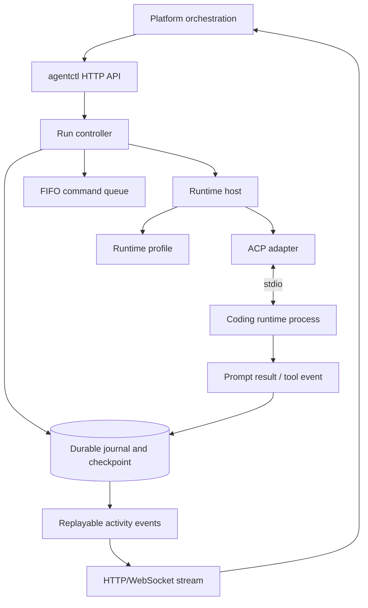
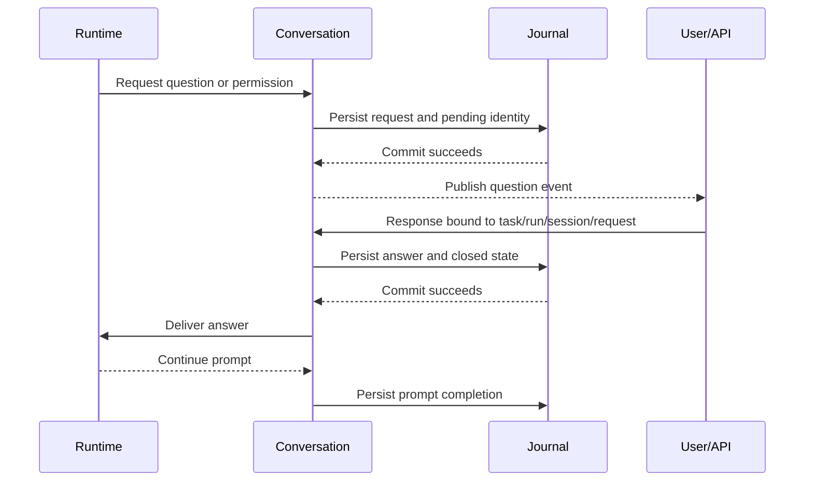

# Agentctl runtime

`agentctl` is an independent worker. It owns runtime processes, ACP protocol
translation, durable journals/checkpoints, prompt queues, and interaction
state; the platform observes it through HTTP and activity streams.

- A prompt is accepted synchronously, then executes FIFO with one active prompt.
  Follow-ups accepted during work or approval remain queued.
- Question responses are delivered only after their journal record commits.
  Task, run, session, and request identities prevent cross-run responses.
- Prompt completion does not complete the run. The queue drains first; terminal
  run completion then stops the runtime and releases confirmed ownership.
- Cancellation pauses remaining work. It does not authorize automatic retry or
  auto-answering an old interaction.
- Restore checks runtime/provider/model, configuration fingerprints, working
  paths, locks, and replay evidence. Missing evidence or credentials blocks
  continuation visibly while retaining files and state.
