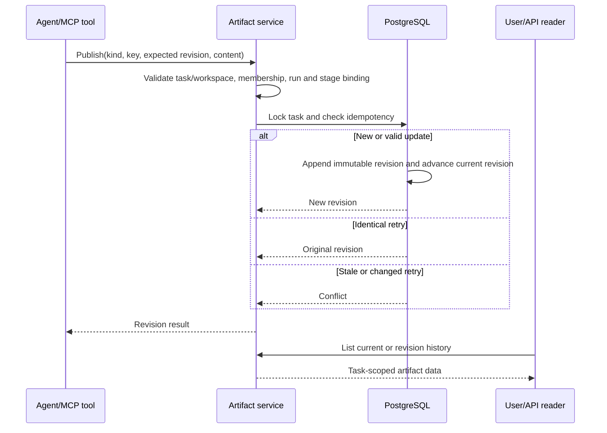
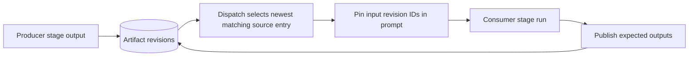

# Artifacts

Artifacts are task-scoped immutable revisions. Agents publish through a
run-bound capability; users and browsers can read revisions but cannot claim a
producing run.

- Every retry uses the same task-unique idempotency key. The same actor/run and
  input returns the original revision; a changed input or stale revision is a
  conflict.
- Input selection happens before reservation and the exact prompt/outbox stores
  the selected revision IDs. Later artifact edits cannot change an accepted run.
- Required inputs reject a consumer start and expose an automation failure;
  optional inputs resolve to an empty list. Artifact outputs do not gate producer
  completion.
- External URLs are references, not fetched snapshots. Provider IDs belong in
  metadata when reproducibility matters.
