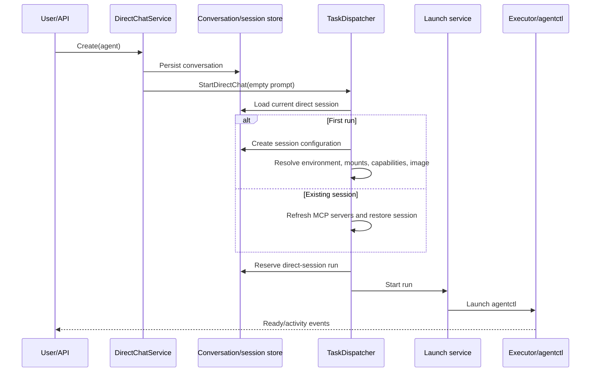
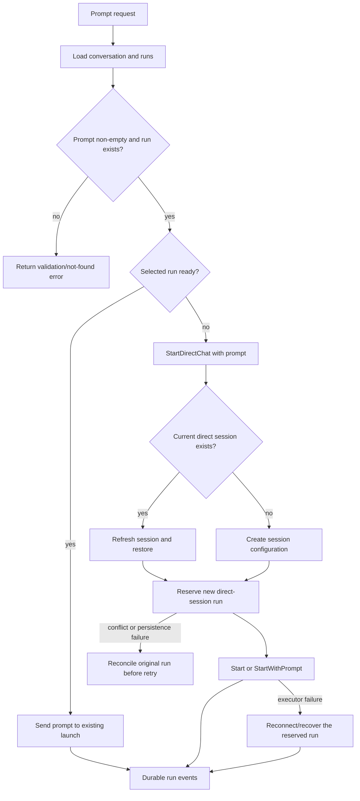

# Direct conversations

Direct conversations use the same durable launch and agentctl boundaries as
task execution, but the conversation ID is the task-shaped identity. Creating a
conversation creates its first run; subsequent prompts either reuse a ready run
or create a new run that restores the existing direct session.

- Conversation persistence happens before its initial launch. If dispatch fails,
  the conversation remains visible and the failed start must be reconciled;
  creation does not silently roll back the conversation row.
- A follow-up carries `RestoreSession=true` when a current session exists. The
  run reservation is durable before any executor call, and an auto-generated
  command ID is used when a prompted start did not supply one.
- A direct prompt is rejected when its conversation or run is unavailable, and
  blank prompts are rejected. A ready run receives the prompt directly; any
  other run goes through the new reservation/launch path.
- Launch completion uses persisted terminal intent, process termination, and
  final launch status as documented in [execution and recovery](execution-and-recovery.md).
