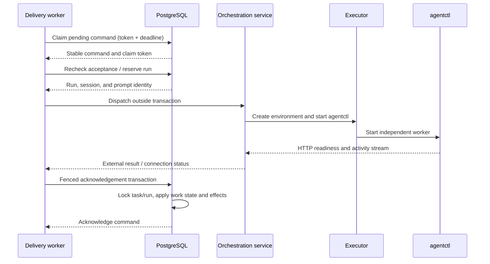
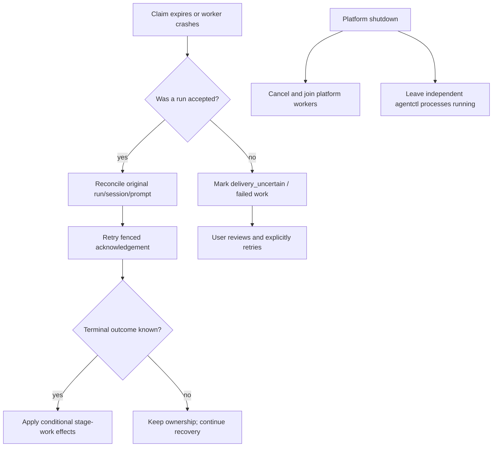

# Execution and recovery

Workflow commands use durable, fenced delivery. The platform reserves a stable
run identity before contacting an executor, and an expired claim can reconcile
an accepted run but cannot authorize a replacement launch.

- Claims grant permission to reconcile or deliver one command, not ownership of
  the task or an already-running process.
- Claim, reservation, launch, and acknowledgement are deliberately separate:
  database transactions are short and never contain external process or HTTP
  calls.
- Claim tokens fence stale workers. Run IDs fence obsolete same-stage terminal
  outcomes, and stage-entry versions reject stale entries.
- Missing acceptance is not proof that an external call did not happen. The
  platform records uncertainty rather than blindly launching a second run.
- Executor selection is an adapter concern: Docker, Local, and Kubernetes
  create the environment while orchestration owns run/session identity.
