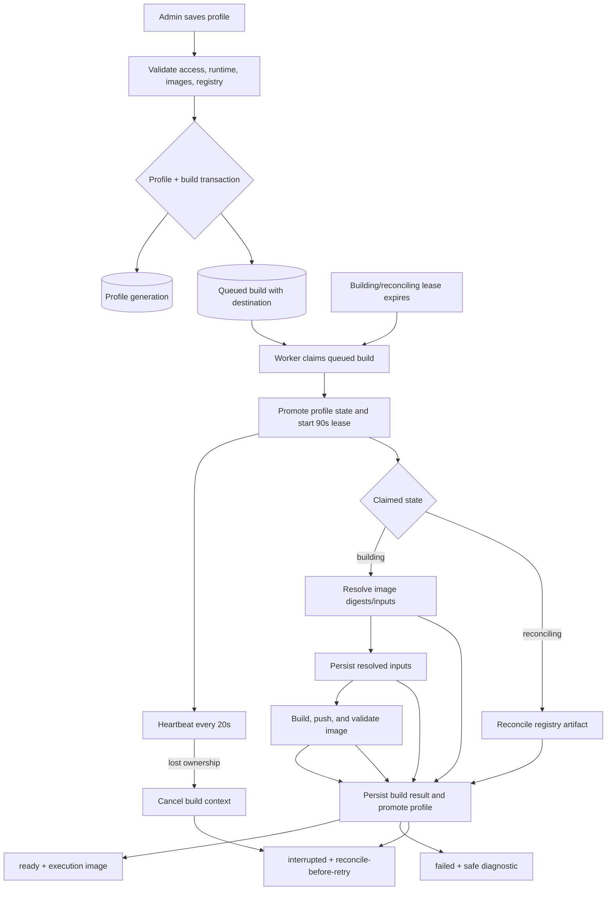
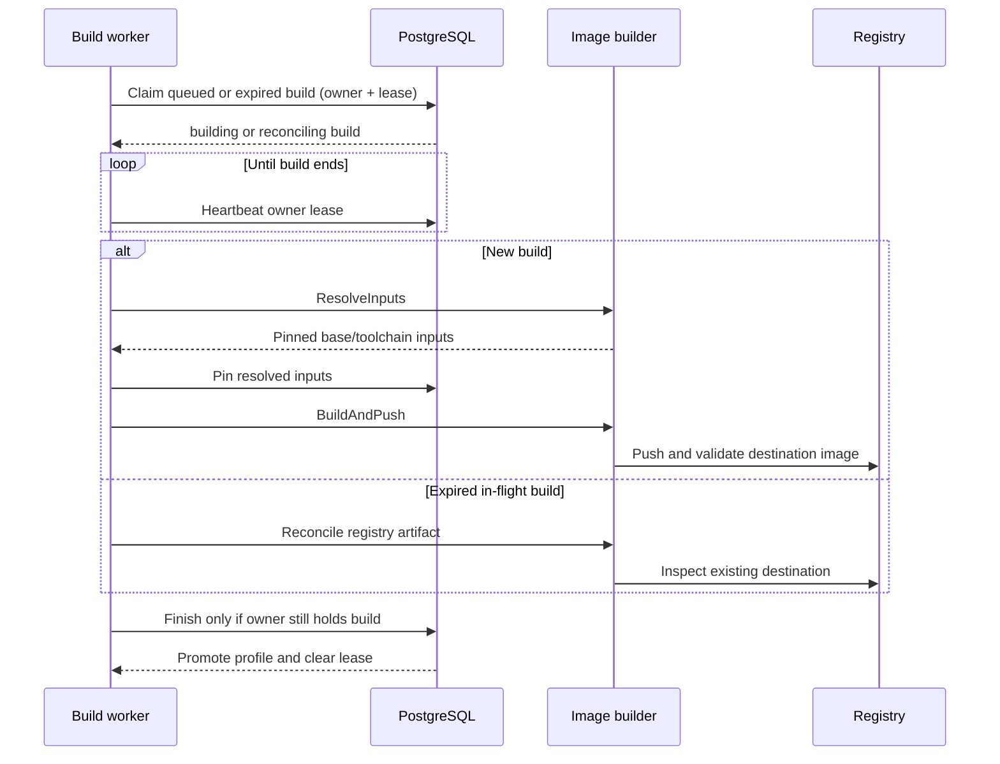

# Execution profiles

Saving an execution profile snapshots its build inputs and enqueues a build in
one database transaction. Workers lease builds so queued work, expired workers,
and uncertain registry outcomes can be handled without concurrent ownership.

- A queued build is claimed as `building`; an expired `building` or
  `reconciling` lease is claimed as `reconciling`. Reconciliation inspects the
  registry and does not start another build.
- Input resolution and pinning occur before external build effects. A lost
  heartbeat, timeout, or uncertain reconciliation outcome is persisted as
  `interrupted`, requiring registry reconciliation before an explicit retry.
- Ordinary input, registry, or compatibility errors become `failed` with a
  safe diagnostic. Successful builds become `ready` only after the build image
  and profile promotion are committed under the owner fence.
- Finish is owner-conditional. A stale worker cannot overwrite a newer claim,
  and profile generation prevents an older build from replacing newer inputs.
