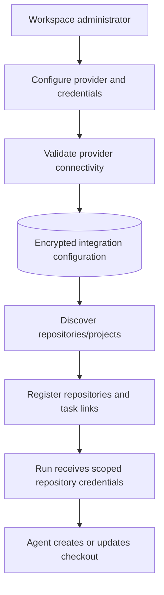
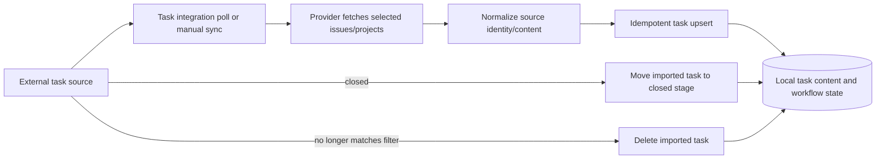

# Integrations

Coding integrations provide repository discovery and credentials. Task
integrations import source work into local tasks. They are configured separately
and synchronize idempotently within workspace scope.

- Integrations are organization/workspace scoped and are never a substitute for
  task authorization. Viewers remain read-only.
- Coding credentials are write-only in configuration APIs, encrypted at rest,
  scoped to provider hosts, and injected only into the required execution
  environment. They must not enter logs, artifacts, or Git configuration.
- Imported title, description, labels, and source URL remain source-managed;
  local stage, assignment, and execution state remain local.
- Source synchronization updates by stable source identity. Source closure
  enters the configured closed stage; leaving a selected filter deletes the
  imported task according to the integration policy.
- Provider-specific API calls and field mapping stay in adapters; task and
  workflow services consume normalized facts.
