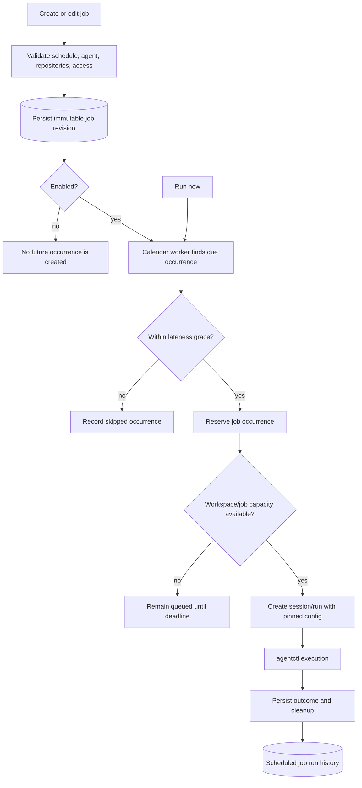
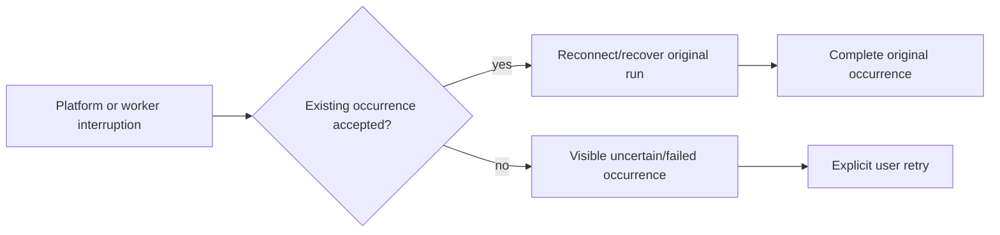

# Scheduled jobs

Scheduled jobs are workspace-scoped and independent of task stages. Each
occurrence gets separate durable execution identity and retains its original
configuration during recovery.

- Daily, weekly, and five-field cron schedules are evaluated in the configured
  IANA time zone. Repeated DST times run once; nonexistent local times are
  skipped.
- A job does not overlap itself, and the workspace allows one active scheduled
  execution. Approval waits and uncertain ownership retain capacity.
- Pausing does not cancel queued or active occurrences. Failed runs are not
  automatically retried; the next calendar occurrence is independent.
- Repository IDs and the agent/runtime/model configuration are snapshotted for
  the occurrence and revalidated at launch. External effects remain
  agent-reported and require reconciliation before a user retry.
