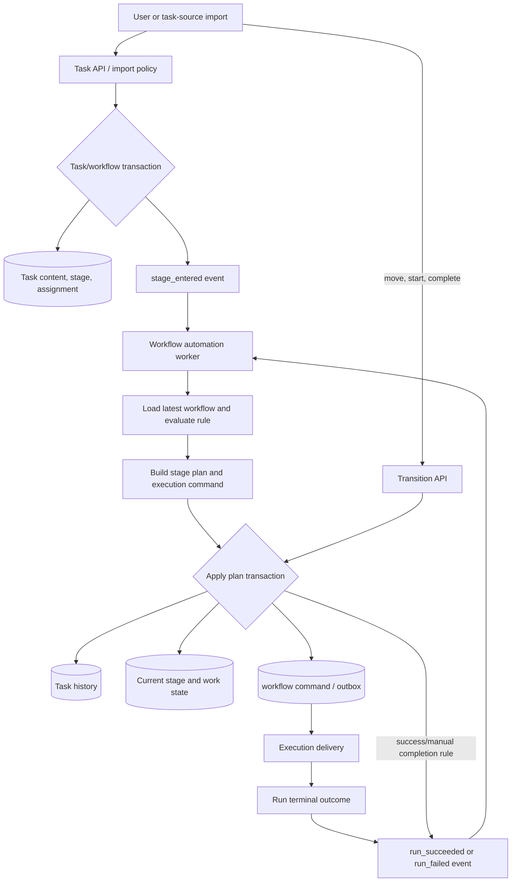
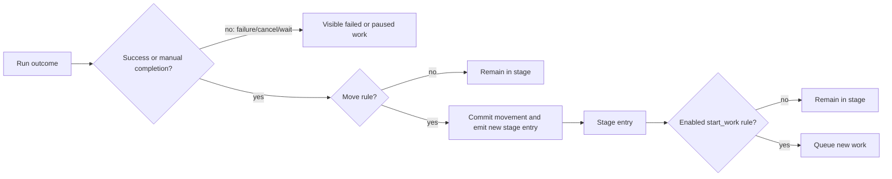

# Tasks and workflows

Task content and workflow position are separate concerns. User actions and
imports update task state under the workflow lock; automation reacts to durable
events and never silently undoes a committed movement.

## Important branches

- Entry rules can start work but cannot move tasks, which prevents movement
  loops.
- Assignment, reopening, and movement do not start execution unless a rule or
  explicit start creates a command.
- A committed movement survives a delivery failure. An uncertain delivery is
  visible and requires explicit retry after reconciliation.
- The seeded board uses `In progress` entry to start work and success/manual
  completion to move to `In review`; custom workflows have no implicit rules.
- Workflow configuration saves validate against locked references and do not
  emit retroactive events.
