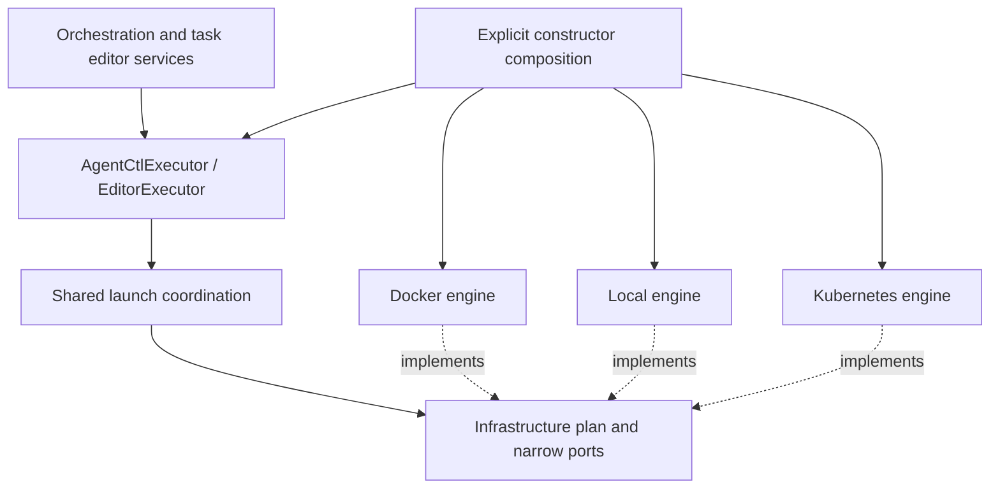

# Executor-agnostic infrastructure engines

Status: implementation complete, live qualification open, requested 2026-11-15.
Agent and editor execution use generic workload plans; Docker supports workload
groups and private networking, and all providers persist operation manifests.
Lint, architecture checks, focused suites and Docker-tagged integration compilation
pass. Credentialed live runtime qualification remains incomplete.
Baseline: PR #113 plus `db82ca7`.

This supersedes the engine-boundary design in
[the previous plan](executor-engine-plan.md), including its allowance for engines
to recognize executor classes. Existing verification evidence remains historical
evidence for that implementation only. Product behavior, runtime/session pins,
authorization and recovery requirements remain authoritative.

The neutral contract makes cross-workload endpoint references explicit and
validates endpoint, probe, and conflicting mount references. Kubernetes stores
workload environment values in owned Secrets rather than Pod specs. Generic engine
plans are the only launch path for agent and editor workloads.

## 1. Design rule

Executors decide what to run and why. Engines implement infrastructure operations.
An engine must run a valid infrastructure plan without knowing whether it was
produced by an agent, editor, scheduled job, or a future executor.

Adding an engine requires support for documented infrastructure primitives and
capability validation. Adding an executor requires no changes to engines when its
plan uses supported primitives. Unsupported guarantees fail before resource creation.
Capability support does not imply live qualification.

Do not replace class switches with registered agent/editor handlers, callbacks,
string comparisons, or per-provider implementations in executor packages. Those
retain the same coupling behind another interface.

## 2. Current coupling to remove

| Current location | Coupling | Destination |
| --- | --- | --- |
| Engine contract | Former class-based launch, executor scope, agent workspace APIs | Generic workload plans, opaque group identity and storage bindings |
| Docker implementation | Former agent ports, runtime selection, fixed mounts, editor launcher | Generic workload, endpoint, mount, network, and lifecycle translation |
| Kubernetes implementation | Former agent-only launch assumptions | Generic plan validation and supported Kubernetes resource translation |
| Local implementation | Former agent-only launch assumptions | Generic native workload lifecycle |
| Composition | Shared engines provided to executor planners | Manual constructor injection through `InfrastructureEngine` |

Application labels may be passed as opaque owner metadata for filtering and
round-trip projection. They must never select engine behavior. Engine-owned labels
carry version, installation, resource group and component identity separately.

## 3. Ownership and dependency direction



- Server services retain authorization, explicit starts, idle proof, handoff,
  generation leases and user-visible lifecycle rules.
- Agent executor resolves runtime/image, argv, environment names, credentials,
  repository preparation, session-home paths and configured restart policy.
- Editor executor resolves image/mode, manifest, required isolation, readiness
  probe and any authenticated forwarding workload.
- Shared launch coordination validates/binds plans and owns common group lifecycle
  and durable operation records. It has no executor-type dispatch.
- Engines translate neutral requests into Docker, Kubernetes or OS operations.
  They enforce the supplied constraints against actual infrastructure.
- Composition resolves provider settings, generic credential bindings and supported
  execution mode, then assembles both executors once. Shared executors never import
  concrete engines. Engines never import executor packages or runtime catalogs.

Use the existing adapter boundary; create focused files/packages only when needed.
Use narrow consumer-owned ports, explicit constructors and plain data. No plugin
registry, arbitrary resource graph, DI container, or embedded provider SDK objects.

## 4. Neutral plan and engine contract

The following is a design sketch; validate exact Go types in the first vertical
slice. One logical launch owns a small group: agent process alone, or browser
process plus optional forwarding process and their private network/files.

```go
type Engine interface {
    Validate(context.Context, Plan) error
    ResolveStorage(context.Context, StorageRequest) (StorageBinding, error)
    Start(context.Context, Plan) (Group, error)
    Inspect(context.Context, GroupRef) (Observation, error)
    List(context.Context, Selector) ([]Group, error)
    Stop(context.Context, GroupRef) error
    Cleanup(context.Context, GroupRef) error
    Close() error
}

type Plan struct {
    Identity   GroupKey
    Metadata   map[string]string // non-secret opaque caller metadata
    Workloads  []Workload
    Networks   []NetworkSpec
    Files      []GeneratedFile
    Storage    []StorageAttachment
    Readiness  []Probe
}
```

Concrete value types must describe only the primitives currently needed:

- Workload: stable component ID; container artifact or native executable; literal
  argv and typed endpoint references; explicit environment/secret bindings; working
  directory; mounts; UID/GID; security; limits; explicit restart policy.
- Network: named private connectivity domain; explicit members; ingress and egress
  constraints. Only explicitly declared endpoint publications are permitted.
- Endpoint: component/port/protocol and access policy; named references resolve to
  bind addresses or peer addresses explicitly. Return endpoint maps, not a special
  agent URL or editor access token field.
- Storage: opaque root/volume identity, inspect-only versus ensure intent, relative
  subpath, access mode, durability and setup-access requirements. Resolve handles
  to host paths/PVC subpaths internally. Callers choose names such as `work` and
  `agentctl-state`; engines do not interpret them.
- Mounts: explicit attachments, read-only ancestry and writable child roots.
  Provider-independent validation forbids escapes and contradictory mounts.
- Credential binding: opaque binding ID, file/environment target and access mode.
  Composition maps binding IDs to allowed host files or Kubernetes Secret keys.
  Engines never know what Codex is or inherit host environment implicitly.
- Probe: target endpoint, HTTP path/expected status and bounded timeout. Engines
  do not select `/health`, `/healthz`, port 8081 or component names.
- Identity: stable group/component IDs with installation boundary, format version
  and provider incarnation handle. Raw caller IDs and hashes have distinct types.

Avoid duplicated requested-capability flags that can disagree with actual fields.
Derive technical requirements from the plan; validate combinations as well as
individual capabilities. An engine must reject an unenforced requirement instead
of ignoring it. Distinguish unsupported, absent, stopped and uncertain outcomes.

`Stop` confirms all executable group members are stopped, including automatic
restart paths. `Cleanup` refuses active/uncertain groups and removes only owned
transient resources; it never deletes durable task storage. Stopped and partially
created groups still require cleanup. Absence of the main process does not prove
absence of its network, forwarding process, Service or environment Secret.

## 5. Editor networking and shared-storage safety

The editor planner specifies a browser workload on an egress-denied private network.
When direct private gateway routing is unavailable, it adds an authenticated
forwarding workload with a loopback publication and an explicit upstream reference.
The forwarding workload image/command/token generation belong above the engine.
Move the existing forwarding program into a reusable, pinned routing artifact or
configuration shared by the planner; engines must not contain code-server paths,
relay environment variable names, token extraction, or HTTP authentication logic.
Choose and document the artifact packaging in the vertical slice; no publishing
is authorized by this plan.

Engines report generic routing/attachment capabilities. The shared planner chooses
a supported topology without inspecting engine kind. Docker realizes bridges,
attachments and port publications. Kubernetes must reject network isolation it
cannot enforce; Pod creation alone is insufficient. Local remains unavailable for
editor plans until it can enforce their constraints.

Storage admission has two distinct owners:

1. Server/editor policy determines whether read/write access is allowed and holds
   the existing task admission lock through handoff.
2. Engines enforce generic shared-storage constraints. Inspect every managed group
   capable of touching a storage root, irrespective of owner/executor type. Verify
   protected ancestry, aliases, privileges and restart behavior against actual
   mounts and infrastructure state. Unknown ownership or unverifiable aliases deny
   admission. A label or stored declaration alone is insufficient evidence.

This replaces `requireProtectedWorkers` with storage-access validation used by any
consumer. Preserve the current
single-active-coordinator restriction; do not claim protection against unrelated
administrators with control of the daemon/host or introduce active-active support.

## 6. Recovery and compatibility

Before creation, persist a versioned operation manifest under durable installation
storage with stable group/component identity, ownership, plan fingerprint,
non-secret topology and resource handles as they become known. Updates must be
atomic and concurrent writers fenced under the existing coordinator assumption.
The manifest is evidence for reconciliation, not proof of live ownership.

Keep secret values out of manifests, metadata, logs and API projections. Use opaque
binding references and existing encrypted snapshots where recovery needs retained
values. Forwarding tokens are memory-only for editor generations; restart stops
old generations before exposing replacement access. Do not recover tokens by
scraping process environments.

On uncertain create/start, reconcile recorded keys and provider incarnation IDs
before retry. Never create a replacement merely because inspection failed. Returned
refs must round-trip through inspect/stop/cleanup, including list results and partial
creation. Use UID/PID fingerprint/container ID preconditions where available.

Resources created by removed executor implementations are outside generic group
reconciliation. New infrastructure groups use the versioned generic identity and
manifest format. Preserve working trees, branches, dirty/untracked
files and compatible runtime/model/session configuration for groups created through
this architecture. Do not silently discard a persisted generic session or claim
continuation succeeded when compatibility cannot be established.

Manifest format changes and rollback effects must be documented. Old binaries must
not coordinate new-format groups they cannot understand. Do not invent a database
migration in advance; use one only if existing storage cannot support the required
durable identity/claim boundary.

## 7. Implementation sequence

1. **Contract and ownership boundary — complete.** Plans contain neutral workload,
   endpoint exposure, storage, security and group identity values.
2. **Docker lifecycle — complete.** One group lifecycle handles single and multiple
   workloads, private networking, mounts, credentials, endpoints and cleanup.
3. **Agent planner — complete.** Runtime, arguments, environment, credentials,
   storage and restart decisions stay above engines.
4. **Editor planner — complete.** Browser and forwarding workloads, private
   networking, generated files, security and lifecycle are expressed as plan data.
5. **Local and Kubernetes — complete.** Each engine validates and realizes supported
   generic primitives and rejects unsupported guarantees before resource creation.
6. **Superseded paths — complete.** Class dispatch, executor-specific launch APIs,
   workspace resolvers, provider-specific editor launch code and duplicate Docker
   single-workload lifecycle were removed.

Credentialed live runtime continuation and live Docker/Kubernetes qualification
remain deployment-level verification work.

## 8. Acceptance and verification

- Generic contract suite: two arbitrary workload labels plus absent metadata behave
  identically for equivalent plans; unknown labels never select a code path.
- Architecture checks prohibit engine imports of agent/editor/runtimecatalog/server
  domains and reject the former executor-class contract. Review plans for hidden
  semantic dispatch that import rules cannot detect.
- Exercise multiple endpoints, arbitrary ports/probes/working directories, generic
  credential targets and explicit restart semantics. `OnFailure` must not translate
  to Docker `unless-stopped`; preserve current behavior through explicit policy.
- Prove `Start -> Inspect/List -> Stop -> Cleanup` round trips after engine/process
  recreation; cover stopped groups, missing main workloads with retained ancillary
  resources, partial creation, stale incarnation IDs and uncertain effects.
- Prove no secret values enter manifests, logs or public responses.
- Preserve real Docker browser/terminal, HTTP/WebSocket gateway, private-network,
  read-only, symlink/alias, stale-discovery and writable-editor handoff coverage.
- Run restore AND follow-up for sessions created through this architecture with
  the pinned runtime and explicit qualified model. Loading history alone is insufficient. Preserve branches and dirty files.
- Use Kubernetes fake API for exact plan translation and ownership boundaries;
  separately qualify live PVC, routing, isolation and process termination. Unsupported
  capabilities must stay unavailable until delivered and verified.
- Run `make fmt`, `make lint`, architecture checks, focused unit/integration suites
  and race detection for group/admission/lifecycle concurrency; run `make check` and
  applicable documented recovery/editor targets. Report unavailable prerequisites
  and unrelated failures precisely; fake tests do not establish live qualification.

Completion means adding a future engine needs only neutral infrastructure knowledge,
and adding a new executor using supported primitives changes no concrete engine.
