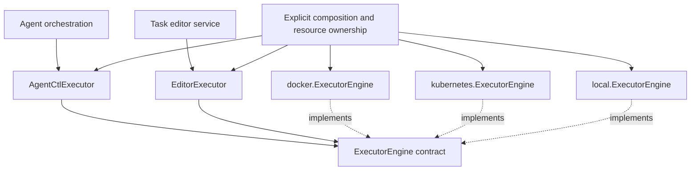

# Shared executors and infrastructure engines: implementation plan

Design follow-up: [executor-agnostic engines](agnostic-executor-engines-plan.md)
supersedes this document's engine-boundary design, including executor-class
recognition inside engines. The follow-up records the implemented generic workload
boundary and its remaining live qualification work.

Status: structural redesign A–E implemented on `refactor/executor-engine`;
editor capability extension F and live qualification remain separate open work.
Last updated: 2026-11-15.
Baseline: `feat/task-editor` at `30461bd`.

This is the implementation and cross-session handoff plan for the user-directed
executor redesign. It replaces the future adapter decomposition in the
[previous extensibility plan](task-editor-executor-extensibility-plan.md), not its
completed evidence or the [task-editor product behavior](task-editor-plan.md).
The architecture below is the selected implementation direction; proposed API
shapes remain implementation details to validate in the first vertical slice.

## 1. Outcome and scope

Introduce two shared, engine-independent executors:

- `agentctl.AgentCtlExecutor`: prepares agent work and constructs its launch plan.
- `editor.EditorExecutor`: inspects existing task storage and constructs its editor
  launch plan.
- `engine.ExecutorEngine`: executes those plans using Docker, Kubernetes, or Local
  infrastructure, including infrastructure discovery and resource cleanup.

Adding a compatible engine must make it usable by both shared executors without
adding an `agentctl/<provider>` or `editor/<provider>` implementation. Compatibility
is determined by explicit requirements and supported capabilities. A process
launcher alone does not establish editor isolation. Unsupported requirements
produce a precise unavailable result, never weakened access or an implicit switch
to another engine.

Deliver the structural migration for all three existing engines, preserving
currently implemented behavior: Docker agents and editors, Local agents, and the
initial Kubernetes agent implementation. Deliver Kubernetes editor support as a
separate qualified extension of the same engine. Local editor support has a
specific feasibility gate described in section 10; its unavailable status must
remain honest until that gate is satisfied.

This work does not change task starts, workflow automation, roles, capacity rules,
worker transport, ACP, runtime/model selection, the editor's always-enabled API,
or the single-active-platform restriction. No database migration, worker wire
change, automatic runtime upgrade, image publishing, or deployment is planned.

## 2. Current implementation and extraction points

| Current code                                  | Responsibility mixed together                                                                    | Destination                                                                         |
| --------------------------------------------- | ------------------------------------------------------------------------------------------------ | ----------------------------------------------------------------------------------- |
| `executors/docker/executor.go`                | Agent image/arguments/environment, checkout preparation, Docker lifecycle, IDs and log transport | Agent policy to `agentctl`; Docker operations to `engine/docker`                    |
| `executors/local/executor.go`                 | Agent arguments/environment, checkouts, host process startup, PID records and termination        | Agent policy to `agentctl`; process operations to `engine/local`                    |
| `executors/kubernetes/executor.go`            | Agent configuration/checkouts, Pod/Service/Secret construction, readiness, IDs and cleanup       | Agent policy to `agentctl`; Kubernetes operations to `engine/kubernetes`            |
| `docker/editor.go`                            | Editor image/mode/manifest, container hardening, storage checks, readiness and cleanup           | Editor policy to `editor`; infrastructure mechanisms to `engine/docker`             |
| `docker/editor_network.go`, `editor_relay.go` | Private networks, authenticated relay, resource-group reconciliation                             | `engine/docker`                                                                     |
| `docker/checkout_mounts.go`                   | Worker mount creation and editor admission against existing worker mounts                        | Shared workspace requirements; engine-owned enforcement                             |
| `docker/task_checkout_inspector.go`           | Engine storage resolution and editor-facing discovery mapping                                    | Storage validation to engine; `taskeditor.Inspection` mapping to `editor`           |
| `docker/host_mounts.go`                       | Session-home target expansion and Docker bind construction                                       | Session target calculation to `agentctl`; safe bind implementation to Docker engine |
| `executors/checkout`                          | Selected Git checkout preparation and scoped credentials                                         | Keep; invoke only from `AgentCtlExecutor`                                           |
| `executors/factory.go`                        | Provider selection, client ownership, executor construction                                      | Select one engine, construct shared executors, own cleanup                          |
| `server/taskeditor`, `server/orchestration`   | Authorization, ownership, idle proof, generation leases and execution handoff                    | Keep policy here; rename editor interface only                                      |

The current `executors.Executor` interface is agent control, not an engine
contract. Do not merely rename that interface and keep `StartAgentctl` inside
engines. Extract the engine contract, preserve the narrow orchestration contracts,
and remove the obsolete aggregate interface when composition is migrated.

## 3. Packages, names and dependency rules

```text
internal/adapters/executors/
    factory.go
    factory_test.go
    agentctl/
        executor.go             # AgentCtlExecutor and consumer interfaces
        configuration.go        # Agent artifacts, environment and credentials
        launch.go               # Engine-neutral launch plan construction
        control.go              # Existing agent process-control methods
        *_test.go
    editor/
        executor.go             # EditorExecutor and consumer interfaces
        discovery.go            # Workspace -> taskeditor inspection
        launch.go               # Mode, image pair, manifest and requirements
        *_test.go
    engine/
        engine.go               # ExecutorEngine composition boundary
        resource.go             # Identity, lookup and observed state
        specification.go        # Launch, workspace and ingress requirements
        capabilities.go
        errors.go
        docker/
            engine.go           # docker.ExecutorEngine
            client.go
            containers.go
            storage.go
            mounts.go
            networking.go
            relay.go
            identity.go
            reconciliation.go
            *_test.go
        local/
            engine.go           # local.ExecutorEngine
            process_unix.go
            identity.go
            storage.go
            *_test.go
        kubernetes/
            engine.go           # kubernetes.ExecutorEngine
            api.go
            workloads.go
            storage.go
            identity.go
            *_test.go
    checkout/                   # Existing checkout preparer
tests/integration/
    executor_engine_*.go        # Cross-boundary/real infrastructure scenarios
```

File boundaries are illustrative; create files when their implementation exists.
Do not introduce empty packages or a generic workload framework.

Dependency direction:



- `agentctl` and `editor` import the neutral `engine` vocabulary and their own
  server consumer contracts, but never concrete engine packages or each other.
- Concrete engines implement the neutral contract and import SDKs/OS facilities.
  They do not import orchestration models, taskeditor, checkout providers, or
  worker runtime implementations. They receive resolved values rather than agent
  definitions, repository credentials, `RunConfig`, or `taskeditor.Spec`.
- `engine` root is the adapter-internal contract jointly consumed by the shared
  executors. It contains no provider SDK, domain service, or operational I/O.
  It does not belong in `internal/contracts/agentctl/v1` or `internal/platform`.
- `agentctl` and `editor` declare the narrow engine interfaces each actually uses;
  `engine.ExecutorEngine` composes those operations for construction. Avoid two
  different launch DTO vocabularies or domain-facing universal interfaces.
- Composition in `executors`/`cmd/server` is the only place selecting a concrete
  engine. Keep existing provider-dependent operator configuration there.

Naming changes:

| Before | After |
| --- | --- |
| Provider `Executor` structs | `docker.ExecutorEngine`, `local.ExecutorEngine`, `kubernetes.ExecutorEngine` |
| Agent behavior embedded in providers | `agentctl.AgentCtlExecutor` |
| `docker.EditorBackend` | `editor.EditorExecutor` |
| `taskeditor.Backend` | `taskeditor.EditorExecutor` |
| `taskeditor.UnavailableBackend` if retained | `taskeditor.UnavailableEditorExecutor` |
| `Selection.Executor` | `Selection.AgentCtlExecutor` |
| `Selection.Editor` | `Selection.EditorExecutor` |
| Docker SDK `EngineClient` and related interfaces | Provider-local client names, clearly distinct from `ExecutorEngine` |

Use the user-selected `AgentCtlExecutor` spelling. Keep the `agentctl` command,
package paths, URLs, serialized values, and existing orchestration method names
such as `StartAgentctl` unchanged. Constructors can remain package-qualified
`New`; configuration types remain package-qualified `Config`.

## 4. Engine contract and data model

The proposed composition interface is:

```go
type ExecutorEngine interface {
    Capabilities() Capabilities
    Validate(context.Context, Requirements) error
    ResolveWorkspace(context.Context, WorkspaceRequest) (Workspace, error)
    Start(context.Context, LaunchSpec) (Resource, error)
    Inspect(context.Context, Lookup) (Observation, error)
    List(context.Context, Selector) ([]Resource, error)
    Stop(context.Context, ResourceRef) error
    Cleanup(context.Context, ResourceRef) error
    Close() error
}
```

`Start` combines infrastructure create/start/connect because no consumer needs a
separate public create transaction. It must return a reconciliation reference on
partial or uncertain creation. `Stop` and `Cleanup` remain distinct: stopped work
is not permission to erase durable files, and confirmed termination is different
from successful removal of ancillary resources.

### 4.1 Required types

| Type | Required content and semantics |
| --- | --- |
| `Scope` | Organization/workspace/task identity, including the existing synthetic scope used for direct conversations and scheduled occurrences |
| `ResourceKey` | Installation, scope, resource class, stable execution ID (run or editor generation), and the minimum qualifier needed for existing naming compatibility |
| `ResourceRef` | Logical key plus opaque concrete identity; distinguish a provisional lookup reference from an inspected concrete ID |
| `Lookup` | Exact reference or stable logical execution query; support current run-ID-only control methods without requiring newly persisted metadata |
| `Selector` | Installation and resource-class boundary, optional scope; never arbitrary unscoped provider filters supplied by browser input |
| `Observation` | Explicit absent, active, or stopped state and resource identity; errors represent uncertainty, never absence; active includes created/starting/restarting/terminating ownership |
| `WorkspaceRequest` | Scope, inspect-only versus ensure-for-agent intent, desired bindings and required workspace guarantees |
| `Workspace` | Opaque storage identity, existence, private preparation directory where supported, resolved workload work/state paths, and compatibility identity |
| `LaunchSpec` | Key, selected program artifacts, literal arguments, environment, mounts/files, endpoint/readiness requirements, restart policy, security/resource limits and sharing requirements |
| `Argument` | Literal argv element or typed reference to a resolved engine binding, such as a named endpoint's listen address; never a shell command/template |
| `Resource` | Concrete/provisional ref, state, private endpoint/access material and round-trippable non-secret ownership metadata |
| `Requirements` | Typed hard guarantees required by a plan; never an arbitrary callback or SDK extension map |

Use typed enums/structs rather than `map[string]any`, provider SDK values, or
`DockerOptions`/`KubernetesOptions` escape hatches in the common contract. API
payload maps may remain private inside the existing Kubernetes REST adapter.
The generic resource must carry enough non-secret editor ownership metadata to
reconstruct user, generation, mode and fingerprint after a platform restart.

### 4.2 Programs, configuration and credentials

- Model container image delivery and native executable delivery explicitly.
  Preserve image entrypoint versus args versus explicit executable semantics;
  editor images currently rely on their entrypoint, while the relay overrides it.
- A program may provide container and native artifacts for the same workload.
  The configured engine uses its supported execution mode. It must not silently
  substitute a runtime/model, fall back from a failed image to a host binary, or
  install missing binaries. Missing required artifacts are unsupported/invalid.
- Select agent runtime images and run-specific execution images in
  `AgentCtlExecutor`; select the editor image pair in `EditorExecutor`. Engines
  do not know the runtime catalog or select images by runtime name.
- Preserve Local's documented ignoring of execution-profile images by using its
  native artifact; keep profile resolution outside the engine.
- Keep execution-mode differences explicit in agent planning. Native versus
  container delivery can use different literal argument forms and host-path
  grants; this is a capability distinction, not a Docker/Kubernetes/Local switch.
  Preserve Local's always-present `-run-id` and container launch's current
  session-conditioned `-run-id` until a separately verified behavior change.
- Resolve provider environment in agent configuration. Explicitly request Local's
  existing allowlisted host environment behavior, including PATH; editor launch
  specs request no host/provider inheritance. Environment merge precedence and
  the matching agentctl `-env` grants must remain covered by behavior tests.
- Represent credential mounts through configured opaque bindings. For example,
  agent policy requests the configured Codex binding only for Codex; Docker maps
  that binding to the read-only auth-file mount, Kubernetes to the operator Secret,
  and Local to its current native-path handling. Engines never select by runtime.
- Keep host bind mounting an explicit capability. Resolve `~/` session-home
  targets using the existing `sessionpath` calculation in agent planning, then
  have the engine validate/materialize safe targets. Do not expose these mounts
  or the agent state directory to the editor.
- Environment values, credential bindings, relay tokens and launch specs are
  internal and must not be generically serialized or logged. Use redacted
  structured diagnostics and explicit secret-safe formatting where needed.

### 4.3 Workspace and filesystem semantics

- `ResolveWorkspace` with inspect-only intent performs no mkdir, chmod, clone,
  manifest write, or process launch. A missing worktree is a normal observation;
  a daemon/PVC/path failure is an error.
- Ensure-for-agent may create the existing task work/state directories and retain
  their permissions. Only `AgentCtlExecutor` uses that intent, before checkout
  preparation. Editor scratch storage is separate from task-state preparation.
- The first contract supports today's shared-filesystem deployments: Docker
  daemon-visible storage, Local host paths, and the Kubernetes PVC also mounted
  in the platform. `PreparationDirectory` is private and allows the existing
  checkout preparer to run once in the shared agent executor. A future remote
  engine without such access must fail this requirement until an explicit
  checkout transport is designed; do not pretend an opaque reference is a path.
- Use `platform/taskstorage` for the unchanged scope hash. Resolve runtime paths
  per engine: container workers retain `/workspace` and `/agentctl-state`, editors
  retain `/task`, and native workers retain their existing absolute host paths.
- Mount sources are scoped storage references or explicit authorized host binds.
  Generated files contain executor-provided bytes and a target binding; engines
  own their materialization, permissions, mounting and generation cleanup.
- Preserve whole-task-workspace discovery, including agent-created files and
  current missing-workspace behavior. Do not narrow visibility to selected repos.
- Workspace sharing is a typed requirement. Agent plans supply selected writable
  repository-relative roots; Docker enforces its protected ancestry mounts.
  Editor starts revalidate matching workers, read-only parents, writable aliases,
  privilege/mount capabilities, and legacy layouts before attaching storage.
- Preserve the existing `protected-v1` label and actual mount validation. A label
  alone is insufficient. The engine rejects unsupported guarantees before launch.
- Include storage and effective engine/editor settings in editor compatibility
  hashing. Preserve structured encoding and keep private paths out of public JSON.

### 4.4 Endpoints, networking and readiness

- A launch requests a named HTTP endpoint and readiness path/timeout, not a public
  Docker port or Kubernetes Service object. Agent configuration supplies `/health`;
  editor configuration supplies `/healthz`. Preserve the launch service's agent
  health/configure/restore sequence rather than moving ACP work into the engine.
- Resolve dynamic native listen addresses before starting the executable. Agent
  argv contains a typed reference to the endpoint binding after `-listen`; the
  engine substitutes the resolved address without understanding that flag.
  Distinguish the workload listen address from the platform-reachable address.
  Preserve loopback-only Local binding and the existing reserve/release behavior
  during extraction; do not claim the present port-selection race is eliminated.
  Container endpoints retain configured internal ports and their private gateway
  or Service address. Never route binding values through shell interpolation.
- Encode worker-control reachability separately from editor gateway-only ingress
  and denied egress. Never attach editor shells to the worker control network.
- Docker maps gateway-only/no-egress requirements to the current generation bridge
  and either trusted platform attachment or the native-host authenticated relay.
  Relay program/image settings are explicit engine construction dependencies;
  avoid embedding code-server application command selection in the engine.
- An endpoint can include private access metadata. `EditorExecutor` maps the
  current relay token into `taskeditor.Instance.GatewayToken`; retain the existing
  gateway header, Origin, cookie, grant and WebSocket behavior.
- Kubernetes maps the same requirements to internal Services and enforced network
  policies. Local cannot claim denied egress just because it binds to loopback.
- Existing engine-specific readiness is preserved during extraction. A timeout
  retains ownership/reference information; it never implies the process stopped.

### 4.5 Lifecycle, uncertainty and errors

- Validate static support before task mutation; validate live prerequisites again
  immediately before creation or storage attachment. Advertised capabilities are
  not proof of current daemon, cluster, CNI, or filesystem health.
- A required field/guarantee cannot be silently ignored. Validate combinations
  such as read-only storage plus writable child overlays, denied egress plus
  private ingress, native programs plus image-only artifacts, and restart policy
  support. Keep explicit existing exceptions, such as Local profile-image
  metadata being irrelevant, at the artifact-selection boundary.
- Start uses stable identities. After a lost create/start response, inspect and
  reconcile the original key. Do not create a second resource or retry ordinary
  failures. Return the known provisional/concrete reference alongside the error.
- Exact-ID operations validate installation, scope and invocation/generation.
  Resolve logical queries to a concrete identity and revalidate immediately before
  mutation. A stale stop must not terminate a replacement or unrelated resource.
- `Stop` succeeds only after workload termination and restart prevention are
  confirmed. For an editor this includes descendants capable of writing files.
  API uncertainty or unreachable-node uncertainty remains an error requiring
  reconciliation/fencing. Do not force-delete a Pod and infer physical termination.
- `Cleanup` removes only owned disposable resources after safe termination or
  proven absence. Preserve worktrees, untracked files, branches, sessions and
  operator-owned volumes/Secrets/networks. Partial cleanup is retryable by identity.
- Preserve generation admission around start and orphan cleanup. Independent list
  snapshots do not prove absence. `List` may reconcile orphan group resources,
  as current editor listing does; document and test those effects explicitly.
- Use typed unsupported, invalid-spec, identity-mismatch and uncertain-operation
  errors with wrapped causes. Only known static lack of support maps to editor
  unavailable capability; operational errors must keep handoff protection active.
- `Close` cancels/joins platform-side streams and releases clients exactly once.
  It never terminates independent workers. Request cancellation bounds API calls
  and waiting; it must not implicitly own the launched worker's lifetime.

### 4.6 Capability evaluation

Implement a small typed capability set with execution mode and supported
guarantees. The first consumers require only these concrete distinctions:

- Container versus native artifacts and the supported endpoint-binding mode.
- Platform-accessible checkout preparation and durable work/state bindings.
- Read-only mounts/root filesystem, temporary mounts, and protected workspace
  sharing with concurrent or restartable writers.
- Gateway-only ingress, enforced denied egress, and private HTTP/WebSocket routing.
- Confirmed worker exit versus the stronger confirmed editor process-tree stop.
- Explicit host binds, configured credential bindings, and supported restart modes.

`Requirements` is derived from a concrete workload plan. A static support check
returns the missing guarantees; `Validate(ctx, requirements)` checks current
operational prerequisites. List/inspection/cleanup of previously created resources
must remain available even when new launches cannot satisfy their requirements.
Unknown capabilities are unsupported; a live operational error is never cached as
an unsupported result.

The structural migration must preserve this support matrix:

| Engine | Agent launch after migration | Editor launch after migration | Additional support gate |
| --- | --- | --- | --- |
| Docker | Existing container behavior | Existing writable/read-only behavior | Rerun real security/browser/recovery qualification |
| Local | Existing trusted native behavior | Unavailable: missing isolation/sharing/process-tree guarantees | Section 10.2 feasibility and enforcement evidence |
| Kubernetes | Existing initial container behavior | Unavailable until engine extensions are delivered | Section 10.1 PVC/sharing/network/fencing qualification |

Support is not a boolean synonymous with production qualification. Record which
engine operations are implemented and which deployments/scenarios were verified.
Do not add per-provider branches in shared executors to work around a missing
guarantee or a capability matrix inferred solely from engine names.

## 5. Shared executor behavior

### 5.1 AgentCtlExecutor

Implement the existing `orchestration.AgentctlStarter` and
`orchestration.AgentProcessController` interfaces. Keep these steps explicit:

1. Validate `RunConfig`, agent artifacts, host-mount support and engine guarantees.
2. Obtain an ensure-for-agent workspace using the original task scope.
3. Invoke the existing checkout preparer with selected repositories and scoped
   credential resolution; preserve existing branches and files.
4. Resolve agentctl arguments, agent environment, runtime-specific credential
   binding, session-home mounts, restart intent and protected writable roots.
5. Build the neutral spec using resolved execution paths, then call engine Start.
6. Map the resource reference and endpoint to the existing `model.Process`,
   including identity on partial failure. The launch service persists it and
   retains its existing configure/connect/start-or-restore/prompt responsibilities.
7. Implement current running/terminate methods through engine inspection and
   Stop/Cleanup, including run-ID lookup when the original create response was lost.

Do not duplicate reservation, queue, command acceptance, approval, retry or
workflow logic in this executor. Keep runtime/provider/model configuration pinned
to the existing session resolution path.

### 5.2 EditorExecutor

Implement the renamed `taskeditor.EditorExecutor` interface with unchanged method
signatures: checkout inspection plus StartEditor/InspectEditor/StopEditor/ListEditors.

1. Map engine workspace inspection into `taskeditor.Inspection`. Keep task
   authorization, selected-registration resolution, and workspace JSON generation
   in `taskeditor.Discover`.
2. Validate discovery's storage identity again before start; check supported
   read-only/private-ingress/no-egress/workspace-sharing requirements.
3. Select the writable or immutable read-only image, editor environment, manifest
   file, resource limits, non-root/read-only-root filesystem and temporary mounts.
4. Construct a neutral launch spec containing the supplied owner/generation/mode/
   fingerprint. Engines enforce mechanisms but never decide whether the user is
   authorized, the task is idle, or the mode should be writable.
5. Translate endpoint/access metadata and observed ownership into the existing
   instance type. Preserve owner and generation reconstruction after restart.
6. Stop and clean up via the engine, confirming termination before success. List
   only this installation's editors and reconcile owned ancillary resources.

The task-editor service retains locking, independent authorization watchdogs,
lease revocation, generation changes, compatibility decisions and handoff.

## 6. Composition, availability and shutdown

- Retain one explicit engine factory switch. Construct one configured engine and
  inject it into both shared executors; no registry, plugin loader, reflection or
  runtime downcast to Docker client methods.
- Keep `ORKEST_EXECUTOR=docker|local|kubernetes` and the existing defaults/settings.
  Move provider configuration types to their engine packages; separate agent
  artifacts/provider environment from infrastructure configuration. No new gate
  such as `ORKEST_EDITOR_ENABLED` is introduced.
- `Selection` exposes named agent/editor contracts, engine kind/support metadata,
  and one `Close` owner. Use the current copy-safe once-only cleanup behavior.
- Construct the shared editor executor for every engine. Derive static editor
  support from its requirements and the engine's capabilities, without a provider
  switch in editor policy or server services. Preserve the always-present API and
  precise unsupported result.
- Startup discovery/cleanup must still run against the real engine even when new
  editor creation is unsupported. Old editor resources must not be hidden behind
  an unavailable placeholder. Failure to inspect or stop discovered resources
  blocks startup; downgrading capability does not revoke physical writers.
- For a statically unsupported engine with confirmed absence of editors, preserve
  agent-only behavior and do not install an unavailable handoff guard. For a
  supported configuration, install the guard even if the daemon/cluster is down;
  never downgrade operational failure to unsupported and bypass it.
- Preserve startup order: construct dependencies, reconcile old editors, install
  supported handoff/mutation guards, then reconnect recorded workers and admit
  queued/workflow/job delivery. No executable delivery may race reconciliation.
- On shutdown revoke gateway/editor leases, cancel and join editor reconciliation
  and platform-side worker/log supervision, then close the engine/clients.
  Platform shutdown leaves active independent agents running. Do not add an
  unrequested stop-all operation.
- On partial construction failure close only resources already owned by that
  composition. Shared executor constructors borrow the engine and cannot close it.
  Direct test fixtures own their engine explicitly; remove the agent-to-editor
  construction convenience method rather than preserving their coupling.

## 7. Provider migration details

### 7.1 docker.ExecutorEngine

- Move Moby interfaces/client ownership, container operations, endpoints and
  platform-side log transport into the engine. The shared agent executor selects
  log redaction/context; retain `platform/agentctllogs` behavior.
- Translate neutral mounts, authorized host binds, generated files, security
  settings and restart intent. Preserve current session-qualified restart behavior:
  session-backed workers use `unless-stopped`; non-session launches and editors
  do not acquire that restart policy. Do not normalize this to Kubernetes behavior.
- Retain numeric UID/GID resolution, editor non-root fallback, resource limits,
  read-only image/root filesystem, temporary filesystem limits and capabilities.
- Move current private network/relay and protected-checkout checks without
  weakening them. Preserve network removal refusal while live endpoints remain,
  unrelated endpoint protection, stale-snapshot reconciliation and generation locks.
- Set agent restart defaults explicitly in composition: Docker session-backed
  workers request `unless-stopped`, while Kubernetes/Local workers request their
  existing no-infrastructure-restart behavior; editors always request no restart.
  Pass the resolved policy into shared agent configuration and then LaunchSpec.
  Do not make a shared executor test the concrete engine kind or make Local
  pretend it implements Docker restart semantics.
- Keep resource groups private: worker container, or editor container plus optional
  relay/network/generated files. Stop/Cleanup manages the group by ownership.
- Preserve legacy labels, names, scope hashes and concrete IDs. Isolate historical
  identity encoding in `identity.go`; engines may recognize resource classes for
  compatibility codecs, never to select application commands/images/configuration.
- Supply legacy runtime-qualified name candidates from composition/agent query
  metadata rather than importing runtime-selection behavior into the engine.

### 7.2 local.ExecutorEngine

- Move executable startup, allowlisted host environment application, port binding,
  stderr/log transport, reaping and PID/fingerprint records into the engine.
  Runtime arguments, provider grants and Codex selection remain in agent policy.
- Preserve PID plus start-time/command fingerprint identity and current run-record
  filenames/content; reattach after constructing a new platform engine instance.
- Preserve detached lifetime (`exec.Command`, not request-owned CommandContext).
  Keep coordinated goroutine cleanup without waiting for a live worker at platform
  shutdown. Bound startup cleanup without losing the reconciliation identity.
- Preserve Local's native work/state paths, PATH behavior, ignored image profiles,
  and host-mount rejection. Do not claim protection from other same-user processes.
- Extract current worker lifecycle first. Process-group/descendant fencing and
  isolation are separate work needed for editors; current parent-only observation
  does not satisfy the stronger editor termination guarantee.
- ResolveWorkspace inspection remains non-mutating, but generic editor launch
  rejects unsupported isolation/sharing requirements before creating anything.

### 7.3 kubernetes.ExecutorEngine

- Move in-cluster REST client, Pod/Service/Secret translation, readiness/log
  transport, UID deletion preconditions and cleanup into the engine.
- Preserve platform-mounted RWX PVC preparation, DataSubpath containment, non-root
  UID/GID, service accounts without token automount, image-pull references, request/
  limit configuration, graceful timeout, and `restartPolicy: Never` for workers.
- Translate selected sensitive environment into an owned Secret and named
  credential bindings into existing operator-owned Secret mounts. Cleanup must
  distinguish owned run Secrets from operator credentials.
- Preserve namespace/name/UID process strings, resource names/labels, Service DNS
  endpoints and ownership checks. The neutral spec supplies historical qualifier
  metadata without requiring orchestration/runtime types inside the engine.
- Add fake API coverage now: the current package has no ordinary tests. Cover
  conflict/UID changes, partial Service/Secret/Pod creation, API uncertainty, and
  delayed deletion before changing support claims.
- Keep editor unsupported during the extraction. Section 10 defines the added
  primitives and evidence required to advertise its editor capabilities.

## 8. Persisted compatibility and recovery

Before moving code, record fixtures for every persisted or externally observed
identity. The refactor must retain these formats unless a separate migration is
designed and qualified:

| Existing identity/state                                                                          | Compatibility requirement                                                             |
| ------------------------------------------------------------------------------------------------ | ------------------------------------------------------------------------------------- |
| `tasks/<SHA256(JSON([org,workspace,task]))>/{work,agentctl-state}`                               | Exact bytes/path calculation across all three engines                                 |
| Docker worker names and pre-runtime-qualified fallback names                                     | Existing run-ID-only inspection/termination finds both                                |
| Docker managed/scope/runtime and `protected-v1` labels                                           | Old resources are discovered; unprotected workers continue but cannot share an editor |
| Docker concrete IDs and uncertain-create deterministic names                                     | Launch recovery accepts both without replacing a possibly live worker                 |
| Local `runs/<run-hash>.pid` and `PID:fingerprint`                                                | Recreated engine reads old records and rejects PID reuse                              |
| Kubernetes `namespace/name/uid` and provisional empty UID                                        | Preserve parser, owned-resource validation and UID-safe cleanup                       |
| Kubernetes Service/Secret names, labels and stable DNS                                           | Existing launches reconnect without a newly formatted endpoint                        |
| Editor installation hash, task name, generation labels, relay/network names and manifest paths   | Startup discovers and safely stops old editor groups                                  |
| Worker arguments, runtime homes, session IDs, image identity, model and permission configuration | Continued sessions remain compatible and pinned                                       |

Trace an existing session through `TaskDispatcher`/session configuration,
LaunchService StartAgentctl, recorded connection recovery, Configure, RestoreAgent,
and the next queued/user prompt. Include direct chat, scheduled work, workflow
dispatch and integration-triggered follow-ups in call-site review.

Test both a previously created live worker surviving platform reconstruction and
a stopped/recreated worker loading old durable state and answering a follow-up.
Assert unchanged logical run/session where recovery requires it, retained branch
and untracked files, and no duplicate prompt/worker. A new user revision remains a
new run. Failed compatibility preserves state and exposes the reason.

The new Resource/LaunchSpec are in-memory adapter types, not a new persisted
format. Keep current model.Process IDs and endpoints at the persistence boundary.
Editor compatibility hashes may safely force generation recreation after startup
cleanup; agent session fingerprints must not change due solely to this refactor.

Deployment retains existing restrictions: stop old platform writers, leave
independent workers running, and reconcile before enabling delivery. No mixed
platform coordination or execution ownership is granted by delivery claims. Before
rollback, use a guarded version to terminate editors and reconcile uncertain work;
do not assume old code can interpret future unsupported engine resources.

## 9. Ordered delivery increments

Check off implementation only when its acceptance and evidence are recorded.
Each increment must compile and preserve supported behavior. Temporary internal
adapter bridges are permissible within the migration but must have explicit
removal in increment E; do not retain duplicate launch implementations or public
forwarding aliases as the final architecture.

### A. Baseline and contract validation

- [x] Capture current launch arguments, environment merge/grants, mounts, restart
  behavior and identities with representative legacy fixtures.
- [x] Record current tests and infrastructure/model prerequisites before changes.
- [x] Introduce the neutral engine types alongside a working Docker agent vertical
  slice. Validate native-process and Kubernetes mappings before freezing fields.
- [x] Add fake-engine tests of observable shared agent planning and partial-failure
  mapping; do not test trivial field copying in isolation.
- [x] Define capability/requirements validation and errors, including static
  unsupported versus operational uncertainty.

Acceptance: the contract can express all existing launch/security semantics
without provider SDK/domain DTO escape hatches. No persisted format changes.

### B. Docker shared AgentCtlExecutor and EditorExecutor

- [x] Extract Docker infrastructure into `docker.ExecutorEngine` for agent
  workloads, preserving existing names and hashed labels.
- [x] Implement shared agent preparation/planning/control over the engine.
- [x] Implement shared editor discovery/planning/lifecycle over the engine.
- [x] Rename editor consumer interfaces and selection fields; update test doubles.
- [x] Switch Docker agent composition to an explicit engine plus shared executor.
- [x] Switch Docker editor factory composition and HTTP browser fixtures to explicit
  engine plus executor construction; no production `Executor.NewEditorBackend` call
  remains.
- [x] Preserve shared-client ownership and partial-construction cleanup tests.
- [x] Move focused launch/identity/mount/security tests beside their new owners
  and cross-component Docker tests to `tests/integration`.
- [x] Update relocated fixture repo-root discovery for the new integration paths.
- [x] Pass available Docker launch, host-bind, editor lifecycle/security/browser
  gates. Session restore and model continuation require an explicitly selected
  model and remain separate live qualification gates.

Acceptance: Docker's existing behavior is reproduced through two shared executors;
neither imports Moby or a concrete engine. Old workers/editors remain reconcilable.

### C. Local engine migration

- [x] Move host-process operations and storage/identity handling to `local.ExecutorEngine`.
- [x] Select native agent artifacts through engine execution capabilities.
- [x] Use the same AgentCtlExecutor and EditorExecutor construction as Docker.
- [x] Keep new editor launch unavailable with specific missing guarantees;
  startup discovery/cleanup still targets real engine resources.
- [x] Verify native worker launch, run-ID lookup, termination, inherited PATH
  grants, credential planning and durable workspace behavior with real host
  processes and shared-executor tests.
- [x] Record that native OpenCode restore/follow-up was not qualified because
  explicit model and credential settings were unavailable; no continuation claim
  is made from deterministic process lifecycle tests.

Acceptance: Local has no duplicate agent launch policy and retains current
behavior. Its editor capabilities do not falsely advertise sandboxing or no-egress.

### D. Kubernetes engine migration

- [x] Extract API/config/resource translation and identity/lifecycle code.
- [x] Use shared agent planning with PVC workspace resolution and Secret bindings.
- [x] Add fake API failure/ownership/cleanup tests and constructor validation.
- [x] Preserve and correct the documented in-cluster/RWX prerequisites and
  current agent/editor feature limits.
- [x] Record real-cluster worker lifecycle/reconnect/restore-follow-up
  qualification as unavailable because no cluster configuration is present.

Acceptance: Kubernetes agent behavior is expressed through the same executor;
no new editor support is claimed from map-shaped fake API success.

### E. Complete structural integration and cleanup

- [x] Remove old provider Executor/EditorBackend implementations and temporary
  bridges. All three provider agent executors and the Docker editor backend are
  removed; Docker and Kubernetes engines own provider operations.
- [x] Finalize factory/Selection ownership, unsupported-state mapping, startup
  ordering and shutdown ordering across engines.
- [x] Update Makefile targets, tagged test paths, docs and actual package mappings.
- [x] Extend architecture checks to reject concrete-engine imports in shared
  executors and domain imports in engines; include negative checker fixtures.
- [x] Update old package mappings only where actual import migration requires it;
  do not add architecture exceptions for the new design.
- [x] Execute ordinary/race/lint/architecture and applicable real qualification;
  record unavailable live model/cluster prerequisites without claiming success.

Acceptance: one shared agent implementation, one shared editor implementation,
three infrastructure engines; no provider switches in shared launch policy.
Current supported functionality remains available, with precise qualification
limits recorded. This is the structural redesign completion point.

### F. Extend and qualify engine editor capabilities

- [ ] Implement Kubernetes primitives and tests in section 10, enabling editor
  support only when the deployment prerequisites can be enforced.
- [ ] Execute the Local feasibility spike and record its decision. Implement Local
  editor capabilities only with proven filesystem/network/process guarantees.
- [ ] Reuse the shared EditorExecutor unchanged; if its contract cannot express a
  needed guarantee, revise the typed contract and all engine conformance cases
  instead of adding a provider-specific editor implementation.

Acceptance: each additional support claim has real isolation, termination,
handoff and browser evidence. Unsupported Local capability remains an explicit
open delivery item, not a completed all-engines editor feature.

## 10. Additional editor support and technical gates

### 10.1 Kubernetes editor delivery

Implement these through `kubernetes.ExecutorEngine`, not `editor/kubernetes`:

1. Non-mutating platform-mounted PVC inspection with contained subpaths and the
   same symlink/path-replacement protections required for read-only sharing.
2. Generic read-only/writable mounts, protected worker ancestry, generated manifest
   binding, immutable read-only image execution, temporary volumes, non-root
   identity, dropped capabilities and resource limits.
3. One generation-owned editor resource group: Pod, internal Service and any
   generated configuration/policy objects. Keep identifiers separate from worker
   groups; ownership metadata must survive platform recreation.
4. Default-deny ingress/egress with narrowly allowed gateway ingress. Require a
   CNI which enforces the policy; no editor-to-peer, worker, API, metadata/host, or
   internet access. NetworkPolicy objects alone do not prove enforcement.
5. Namespace-scoped list and policy/configuration lifecycle permissions where
   needed. Update `kubernetes-rbac.yaml` explicitly; do not widen worker privileges
   or create operator namespaces/PVCs/RBAC automatically.
6. Readiness, generation-safe stop, and resource-group reconciliation with UID
   preconditions. Pod deletion or API disappearance on an uncertain node is not
   sufficient fencing; preserve the existing operator-fencing requirement and
   block agent delivery until termination can be established.
7. Real-cluster tests for denied network paths, terminal access in writable mode,
   terminal denial in read-only mode, saved files, generation replacement,
   platform restart, failed stop and uncertain-node behavior.

If protected task sharing or termination cannot be established in a cluster,
return unavailable for editors in that deployment; do not relax policy.

### 10.2 Local editor feasibility and delivery

The present Local executor is an unrestricted same-user host process. Running
code-server as another host process cannot guarantee read-only task access,
network denial, protected workspace ancestry or descendant termination. A UI
restriction or chmod of shared files does not establish these guarantees.

The first deliverable is a bounded feasibility report with executable probes:

- Determine which supported host OS primitives can enforce per-task filesystem
  access, network denial, process-tree fencing and durable identity across
  platform restart without changing worker session paths.
- Probe a hostile process replacing checkout parents while editor storage is
  resolved; test both active workers and detached descendants.
- Probe terminal children surviving server shutdown, PID reuse and descendants
  escaping a process group. A parent PID disappearing is insufficient.
- Demonstrate that host/provider credentials and other workspaces cannot be read
  by the editor and its descendants, including in read-only mode.

If a supported sandbox can enforce these requirements, implement those primitives
inside `local.ExecutorEngine` and run the shared editor suite. Do not silently
change the trusted Local worker's execution semantics while extracting it.

If it cannot, keep Local editor support unavailable and document the evidence.
The previous Local-agent/Docker-editor proposal is a different infrastructure
composition: it does not establish a Local engine's editor capabilities, and a
Docker editor alone does not fix unsafe same-user worker storage mutation. Treat
such a hybrid or a stronger host sandbox as an explicit follow-up design, rather
than a hidden fallback or an assertion that the structural redesign is unfinished.

## 11. Verification matrix and commands

### 11.1 Observable behavior coverage

| Area | Required scenarios |
| --- | --- |
| Shared agent planning | Selected repos only, correct args/paths, model/runtime preserved, environment grants, Codex binding selection, pinned execution image, no editor credentials |
| Shared editor planning | Inspection is read-only, missing workspace unchanged, whole worktree preserved, correct image/mount mode, no state/provider/host credentials |
| Engine lifecycle | Create/start success; lost response; missing state; partial resource groups; delayed readiness; cancellation; reconnect from new engine instance |
| Identity and cleanup | Legacy IDs, wrong installation/scope, stale generation/UID, PID reuse, repeated Stop/Cleanup, uncertain stop, unrelated resources preserved |
| Workspace safety | Symlink parents, mount aliases, legacy/privileged workers, protected ancestry, mutable references, retained files/branches/state |
| Networking | Gateway-only ingress; denied internet, peer, worker and host-alias paths; private relay authentication; no raw endpoint/credential leakage |
| Handoff | Concurrent Open/Start, queued and restored prompts, approval/input waits, stop failure, startup reconciliation, mutation/removal fencing |
| Availability | Static unsupported preserves agent-only operation; daemon/cluster failure never disables guards; existing editors cleaned after capability change |
| Ownership/shutdown | Shared client closes once across copies; partial construction cleanup; log/watchdog shutdown; independent workers continue |
| Recovery | Pre-refactor session restore plus follow-up, same configuration/path, retained untracked work/branch, approval identity, no duplicate work |

Use a small shared behavioral harness with injected fixtures for the genuine
common engine contract. Keep provider-specific safety tests explicit. Test
capability rejection for unsupported scenarios rather than skipping the entire
suite. Deterministic tests do not establish infrastructure/model qualification.

### 11.2 Required commands after implementation

Retain these public targets while updating their package paths:

```sh
make fmt
make lint
make check
go test -race ./internal/adapters/executors/... ./internal/server/taskeditor ./internal/server/orchestration ./internal/adapters/http/server ./cmd/server -count=1 -timeout=3m
make test-postgres
make test-integration
make test-recovery
make test-docker
make test-task-editor-backend
make test-task-editor-security
```

- `make check` includes lint; do not repeat already successful checks without a
  relevant subsequent change. Run formatting before final lint/check.
- Update `make test-docker` and editor targets to the new engine/integration
  locations while preserving existing test names where useful.
- Retain explicit live `TestDockerLegacyCheckoutContinuation` coverage; add a
  case where state is created by the pre-refactor launch path and continued by
  the new shared executor/engine. Pass explicitly selected
  `ORKEST_DOCKER_TEST_MODEL_PROVIDER` and `ORKEST_DOCKER_TEST_MODEL_ID`; never
  choose a paid/different model to make a check pass.
- Compile/test relevant `docker` and `docker,security` build tags and lint them
  with the pinned linter configuration; the ordinary check excludes those files.
- PostgreSQL/integration tests use documented DSN/identity prerequisites and must
  exercise actual Open/Start/recovery concurrency where that is claimed. Runtime
  tests require pinned binaries, credentials and explicitly selected models.
- Docker checks require a reachable daemon and pinned images; browser checks
  require `TASK_EDITOR_BROWSER`. Record host architecture and network mode.
- Add documented strict Local and Kubernetes qualification targets when their
  fixtures exist. Missing binaries, sandbox primitives, cluster/CNI/PVC, or model
  settings must produce a clear prerequisite failure, not successful qualification.
- `make qualify-runtime` is required when runtime-specific behavior changes or
  broader approval/MCP qualification is claimed; do not infer it from this refactor.

### 11.3 Documentation and final review

- Update `docs/architecture.md` with the implemented dependency graph and extension
  procedure only as each increment lands; retain planned/current distinctions.
- Update `docs/development/task-editor-backend.md`, the main task-editor plan,
  `docs/status.md`, executor references, testing commands and operational notes.
- Keep requirements §3.9/§12 aligned with actual support and qualification; do
  not promote Local/Kubernetes editor aspirations to delivered behavior.
- Review `.env.example`, `cmd/server/configuration.go`, `wiring.go`, Makefile,
  tagged fixtures and architecture checker imports for stale paths/names.
- No OpenAPI/client or database regeneration is expected from internal naming.
  If public behavior unexpectedly changes, treat it as scope to resolve explicitly.
- Inspect the final diff for duplicated business policy, provider branches in
  shared executors, secrets, unrequested runtime/storage changes and unrelated edits.

## 12. Progress and remaining blockers

Planning completed:

- [x] Inspected current Docker/Local/Kubernetes launch, storage, credentials,
  networking, editor lifecycle, composition and recovery integration.
- [x] Recorded target responsibilities, names, contract semantics, ordered
  increments, persisted compatibility matrix and qualification gates.
- [x] Identified the Local isolation/descendant gate and Kubernetes cluster/CNI/
  fencing prerequisites without claiming those capabilities exist today.
- [x] Reviewed the documentation diff and validated four Markdown files for
  whitespace, balanced fenced code blocks, and 26 existing relative links;
  `git diff --check` passed. These are documentation checks, not engine tests.

Implementation delivered on `refactor/executor-engine`:

- Added the adapter-internal, provider-neutral `engine` vocabulary for scopes,
  resource identity, workspaces, launch plans, capabilities, lifecycle and typed
  errors. Added typed program delivery, mounts, generated files, workspace
  sharing, host environment, credential bindings, security, limits, endpoint
  binding and launch-spec validation.
- Added a shared agent-side workspace preparer used by Docker, Local and
  Kubernetes launches for historical task paths, permissions, and selected
  checkout preparation. Kubernetes now derives its compatibility scope from the
  shared resolved workspace.
- Centralized literal agentctl argv construction across all three launch paths,
  retaining Local's unconditional run ID/PATH grant and the containers'
  session-conditioned run ID behavior.
- Composed those shared planning operations into an explicit
  `agentctl.AgentCtlExecutor` owned by each existing provider composition.
- Centralized environment allowlisting and override precedence across the three
  provider launch paths; Local retains its host environment allowlist and PATH
  grant, while container engines inherit host values only for configured
  provider names and retain explicit environment overrides.
- Added `engine/local.ExecutorEngine` for native agent launch, stable run-ID
  identity persistence, inspection/listing, confirmed process stop, and workspace
  ensure/inspect. Its capabilities do not claim editor isolation, protected
  process-tree stop, or denied egress. Factory composition now wires Local through
  this engine and the shared `AgentCtlExecutor`. The duplicate Local executor
  implementation and its obsolete package tests were removed after equivalent
  shared native process coverage was added.
- Added an end-to-end deterministic native process test covering the shared
  executor's dynamic loopback endpoint, native `-run-id`/PATH grants, run-ID
  recovery lookup, and stop. This is process lifecycle evidence only; it does not
  verify OpenCode/ACP session restore and follow-up.
- Renamed the task-editor consumer contract and unavailable implementation to
  `EditorExecutor` / `UnavailableEditorExecutor`; renamed the factory selection
  fields to `AgentCtlExecutor` / `EditorExecutor`.
- Added `editor.EditorExecutor` as a shared discovery, launch-planning and lifecycle
  adapter. Local and Kubernetes factory selections now construct it too; their
  engine capabilities reject starts with explicit isolation requirements while
  keeping inspection available.
- Added `engine/docker.ExecutorEngine` for container launch, hashed identity
  labels, legacy name recovery, checkout protection, host and Codex mounts,
  container security/limits, dynamic endpoints, lifecycle, listing and cleanup.
  Docker factory composition now runs agent workers through this engine and
  shared `AgentCtlExecutor`.
- Added Docker editor lifecycle to `engine/docker`, including legacy editor
  labels/names, immutable manifest materialization, protected worker-mount
  admission, private internal networks, the authenticated loopback relay,
  readiness, generation-safe stop, cleanup and orphan reconciliation. Docker
  factory composition now selects the shared editor executor. The old Docker
  editor backend and agent compatibility package were removed; maintained
  behavior now lives in the engine/shared executor packages.
- Added tagged Docker integration fixtures under `tests/integration` for shared
  agent lifecycle, host binds, session storage restore, editor lifecycle/security
  and browser gateway behavior. Shared agent lifecycle and host-bind tests passed
  against Colima. Editor lifecycle/security/browser checks passed earlier in this
  workstream. Runtime session restore requires a valid explicitly selected model
  even though that test sends no prompt.
- Added Kubernetes fake-API ownership-conflict and partial-create/cleanup tests.
  Real-cluster qualification remains unavailable in this environment.
- Added engine-neutral shared-executor tests for the launch plan, Codex binding,
  environment override, restart policy, endpoint argument and reconciliation ID
  preservation after uncertain startup.
- Docker identity remains compatible with the existing SHA-256 metadata labels;
  new labels contain an installation identifier but no raw organization,
  workspace, task or run IDs. Lookup with known keys restores the logical IDs
  from the caller's persisted identity; list results expose only hashes where
  old labels did not persist the underlying IDs.
- Extended `tools/architecture/check_dependencies.py` with boundaries for shared
  executors and concrete engines, including negative fixtures for provider
  imports and server-domain imports. `make check-runtime-boundaries` passes;
  the Go dependency scan emitted a non-fatal local module-cache write warning.
- Extracted the in-cluster Kubernetes REST client and its narrow API/log-stream
  interfaces into `engine/kubernetes`; added coverage for bearer-token use,
  successful JSON decoding and 404 absence semantics.
- Moved Kubernetes durable workspace resolution into `engine/kubernetes` and
  wired the existing adapter to it. The resolver preserves `taskstorage` hashed
  paths, 0700 work/state permissions, platform-mounted PVC paths, and
  inspect-without-creation behavior. Checkout preparation remains in shared
  agent policy.
- Removed duplicate legacy Local and Kubernetes agent executors. Factory
  selection uses the shared `AgentCtlExecutor` with `engine/local` or
  `engine/kubernetes`; Kubernetes engine lifecycle preserves PVC paths, env
  Secrets, legacy pod labels/names, readiness and UID-preconditioned stop.
- Kept Kubernetes engine configuration with `engine/kubernetes` and moved
  runtime image selection to the shared factory configuration. The redundant
  sibling `executors/kubernetes` package is removed.
- Kubernetes engine tests cover Pod readiness/lifecycle, environment Secret
  references, Codex Secret file bindings, legacy PVC subpaths, wrong run/Pod UID
  refusal, constructor path validation, partial-create identity retention and
  cleanup of owned resources after a failed Pod create.
- Kubernetes worker Pods retain their legacy `Never` restart policy. Shared
  restart-on-failure planning is emitted only when the selected engine advertises
  restart-mode support.
- Structural increment E is implemented. Go unit tests, lint, Docker shared-agent
  lifecycle/host-mount integration, editor lifecycle/security/browser checks and
  architecture checks passed. The session storage restore attempt used a temporary
  placeholder model and failed during model selection; it does not establish
  restore qualification.
- Live Kubernetes cluster/CNI fencing qualification and credentialed OpenCode
  restore/follow-up were unavailable: this environment has no `KUBECONFIG` or
  explicit Docker/runtime model settings. The Kubernetes documentation now
  separates implemented agent behavior from editor and live-cluster limits.
  Local editor remains deliberately unavailable; its OS sandbox feasibility
  report and Kubernetes editor capability extension are increment F, separate
  from the structural acceptance in E.
- No schema, worker wire or public API changes were made.
- Latest verification: `make fmt`, `make lint`,
  `go test ./internal/adapters/executors/... ./internal/adapters/http/server ./cmd/server -count=1`,
  Docker-tagged integration compilation, Docker agent lifecycle/host-bind tests,
  and `make check-runtime-boundaries` passed. The session restore test was
  attempted and could not start with the placeholder `openai/gpt-5-codex` model;
  explicit model settings are required to rerun it. Elevated `make check` passed
  Go tests, lint, boundaries, generated API checks and frontend lint, then failed
  three existing scheduled-jobs UI tests because their empty-state/button
  expectations do not match the current UI; this branch changes no frontend files.

Increments A–E are complete as the structural redesign. Increment F and live
qualification remain explicitly open and are not represented as delivered
editor capabilities.

Record each increment's changed files, exact check commands/results,
infrastructure/model prerequisites, observed limitations and remaining work
here. Structural completion (A–E), additional editor support (F), and production
qualification are separate claims.
