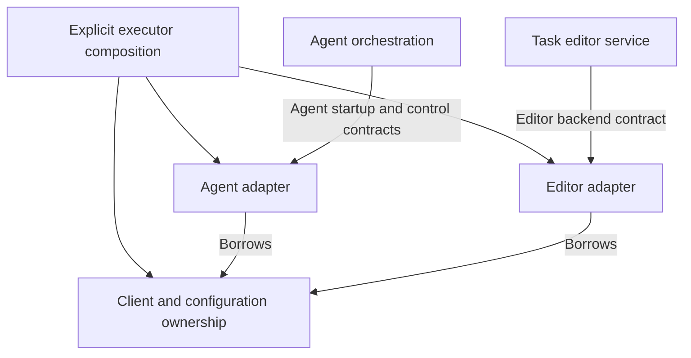

# Task editor executor extensibility plan

Status: increment A implemented; Local/Kubernetes adapter delivery and full release qualification remain.
Last updated: 2026-11-15.

Revision: make adding an executor require adapter code and explicit composition,
without changes to editor policy, agent orchestration, HTTP handlers, or the UI.

This plan follows the PR #111 review discussion. It reduces executor coupling in
the Docker adapter and makes editor capability construction consistent for Docker,
Local, and Kubernetes. The main [task editor plan](task-editor-plan.md) remains
authoritative for product behavior and release scope.

## Goals

- Keep access policy, ownership, generations, and work-delivery handoff in
  `internal/server/taskeditor`.
- Give each executor one cohesive capability that can inspect eligible checkouts
  and manage the editor resource.
- Keep the Docker editor adapter independent of the agent `*docker.Executor`
  while reusing its Docker Engine client and configured resource settings.
- Add Local and Kubernetes support through their executor adapters, without
  teaching the task-editor service about Docker mounts, host processes, Pods, or
  PVCs.
- Preserve the always-present lifecycle API, no-egress policy, persisted task
  storage layout, session compatibility, and current handoff guarantees.

## Design decisions

### One consumer-owned editor capability

Make the `taskeditor.Backend` contract include checkout inspection as well as
editor lifecycle:

```go
type Backend interface {
    CheckoutInspector
    StartEditor(context.Context, Spec) (Instance, error)
    InspectEditor(context.Context, Scope) (Instance, bool, error)
    StopEditor(context.Context, Instance) error
    ListEditors(context.Context) ([]Instance, error)
}
```

`TaskEditorService` receives one backend and uses it for both discovery and
lifecycle. `Discover` continues to own task authorization, selected repository
resolution, and manifest generation. It supplies the selected registrations as
context; inspection preserves the current whole-task workspace behavior. This
keeps authorization and product policy in the server while pairing storage
inspection with the adapter that knows the storage.

Replace `EditorCapabilities{Backend, Checkouts}` in executor selection with one
optional `taskeditor.Backend` capability. Keep `CheckoutInspector` as a narrow
consumer interface: `Discover` needs only inspection, even when its caller passes
the composed backend. One injected capability does not require one implementation
struct; each adapter can delegate inspection to a focused helper.

Keep absence of editor support explicit at composition. Server wiring substitutes
`UnavailableBackend` for the lifecycle API but installs editor handoff guards only
for supported capabilities. This preserves current agent-only operation: the
unavailable backend's `InspectEditor` returns `ErrUnavailable`, so installing it as
a guard unconditionally would block every agent start. A configured adapter's
daemon/cluster outage is an operational error, not absence of editor support, and
must never disable guards. Consolidate this decision in one wiring helper; do not
scatter availability branches across services.

### Docker Engine client ownership

Move the Engine client contracts from `docker/executor.go` into a focused file,
such as `docker/engine_client.go`. Construct the editor backend directly from a
client and a small immutable editor configuration snapshot. The constructor must
work without first constructing a Docker agent executor; Local needs precisely
that combination.

The editor backend should store only what it uses: its Engine operations, data
root, agent network name, editor UID/GID, image pair, and installation identity.
It should not retain `*docker.Executor` or access `Executor.Config` after
construction. Executor selection composes the agent adapter, editor adapter, and
infrastructure resources. Docker agent/editor adapters borrow one Engine client.
Local borrows a separately constructed Engine client only for its Docker editor.
Kubernetes agent/editor adapters borrow the same Kubernetes API client. The
composition owns each resource and closes it once, after editor service activity
has drained. Closing clients must not stop independent agent processes.

Add an explicit `Selection.Close()` cleanup owner, backed by a small stored
cleanup function, and have server wiring defer it rather than assuming
`Selection.Executor.Close()` covers every resource. Preserve existing standalone
agent constructors and their ownership semantics; add a clearly documented
borrowed-client construction path for composed adapters. On partial construction
failure, close only resources already owned by that composition.

Preserve interface segregation: the agent executor can depend on the existing
container lifecycle methods, while an editor-facing Engine interface embeds only
the common container operations and adds listing and network operations. Keep
`Close` and worker-only log operations out of the editor interface. The concrete
Moby client implements both. Local process code and Kubernetes code do not import
the Docker Engine interface; the factory composes Local with the Docker editor.

### Executor-owned storage references

The `taskeditor.Root.Source` value is private and excluded from JSON. Specify it
as an opaque reference interpreted only by the paired executor backend. For
Docker it is a validated host path; for Local it is a daemon-visible task path;
for Kubernetes it may be a PVC-relative path or another adapter-owned reference.
The service may compare or serialize `Root.Path` for the editor workspace, but
must not perform filesystem operations on `Source`.

Rename `Source` to `StorageRef` and document that it is private, deterministic,
non-secret, and valid only for the backend that produced it. It is not an
arbitrary browser-supplied path. Resolve it against configured storage and task
scope again before creation. Keep Docker paths inside Docker and PVC/subpath
translation inside Kubernetes.

The service currently concatenates source strings when computing compatibility.
Replace that with an internal structured encoding of roots and their storage
references before hashing, so boundaries are unambiguous. Public workspace JSON
continues to exclude storage references. Compatibility must change when the mount
identity, mode, or effective editor configuration changes; include an adapter
compatibility key when root references alone cannot express that change.

Remove unused filesystem materialization helpers from the server package, or move
actual materialization into the consuming adapter. Generating code-workspace JSON
can stay shared; writing a bind-mounted file or a Kubernetes resource belongs to
the adapter. Avoid a generic mount, volume, or workload framework.

### Share behavior at the layer that owns it

Agent and editor adapters have different consumers and different lifecycle
contracts. Preserve those contracts instead of combining them into a universal
executor interface. Their shared infrastructure is reused through composition.



For Local, the agent adapter uses host processes and only the editor borrows a
Docker client. Reusing infrastructure is conditional on the actual deployment.

| Concern | Owner and reuse rule |
| --- | --- |
| Authorization, owner, generation, lease revocation, access mode | Shared task-editor service; no executor branches |
| Durable agent delivery, idle proof, process ownership | Existing orchestration services through their interfaces |
| Task storage identity and pure path calculation | Existing `platform/taskstorage` helper after historical-layout compatibility fixtures |
| Git checkout preparation and credentials | Existing checkout adapter; editor discovery must not invoke preparation |
| Container/Pod creation, mounts, readiness, network isolation | Concrete editor adapter |
| SDK/API clients and shutdown ownership | Explicit composition, shared by sibling adapters |
| HTTP grants, cookies, WebSockets, UI | Existing gateway/UI; no executor kind checks |

Keep one explicit factory switch. Adding an executor should add its adapter and
one construction branch, plus configuration and tests. A registry or runtime
plugin loader adds lifecycle and discovery machinery without reducing the real
implementation work and conflicts with the repository's composition guidance.

### Backend behavioral contract

Every adapter must satisfy the same observable rules; matching method signatures
alone is insufficient:

- Inspection never prepares, clones, chmods, or mutates task storage. Preserve
  the current whole-task `work` mount, including agent-created files; selected
  registrations do not silently become a narrower visibility policy.
- Start validates server-resolved scope and storage references, and returns a
  usable generation-bound endpoint or an error. If creation may have succeeded,
  return concrete resource identity when known so cleanup can reconcile it.
- Inspect distinguishes confirmed absence from uncertain observation. An API
  timeout never means the resource stopped.
- Stop targets concrete identity and generation. Repeated Stop after confirmed
  absence succeeds. A stale Stop cannot terminate a replacement, and successful
  Stop confirms editor processes and descendants can no longer write task files.
- List is installation-scoped. Keep existing Docker orphan cleanup behavior
  during the refactor; if discovery can mutate managed resources, document that
  explicitly and use the same generation admission and ownership checks.
- Lifecycle operations honor cancellation and bounded deadlines. Cleanup errors
  retain retry intent. Private endpoints, storage references, and relay tokens
  do not enter public responses or ordinary logs.
- Connectivity permits only the trusted gateway to reach the editor. Terminal
  internet egress, peer access, and worker-control access remain blocked.
- Unsupported capability is explicit at composition; operational uncertainty
  from an installed capability fails closed and preserves existing ownership.

## Implementation sequence

### 1. Lock down the contract

- Review every use of `Root.Source`, `Root.Path`, and `Discovery.Manifest`.
- Record the current whole-task workspace behavior as the baseline; the older
  selected-checkout-only discovery plan is historical and must not change scope.
- Add interface comments describing which layer creates and interprets each
  field, including the privacy guarantee for executor storage references.
- Confirm that mode, selected checkout identity, scope, and generation are
  sufficient inputs for all three executor implementations.
- Keep the task-owned `EditorMutationGuard` interface in `internal/server/task`;
  `TaskService` is its consumer.

**Acceptance:** the task-editor service cannot import or type-switch on an
executor package, and storage references never enter API responses or logs.

### 2. Consolidate capability wiring

- Add checkout inspection to `taskeditor.Backend`.
- Pass the backend to `Discover` through its existing narrow inspector contract.
- Remove the separate inspector field and constructor argument from
  `TaskEditorService`.
- Have `UnavailableBackend` satisfy the complete contract.
- Replace the two-field `executors.EditorCapabilities` with an optional backend
  field on `Selection`.
- Centralize API fallback and supported-only guard installation in wiring before
  startup reconciliation and worker recovery. Cover all current mutation,
  import-removal, launch, connection, workflow, and recovery hook registrations.

**Acceptance:** supported selections expose one complete capability. Unsupported
selections retain unavailable editor APIs and working agent launches. A supported
backend outage continues to prevent unsafe delivery. Shared services have no
executor kind checks.

### 3. Decouple the Docker editor backend

- Extract the Engine interface declarations into `docker/engine_client.go`.
- Keep a worker-facing interface and an editor-facing extension so unrelated
  agent tests do not need editor-only methods.
- Change `EditorBackend` to hold the editor-facing client and resolved editor
  settings instead of `*Executor`.
- Introduce the composed resource owner and borrowed-client constructors. Share
  one concrete client for Docker agent/editor adapters, with selection cleanup
  as the sole owner for that construction path.
- Move the Docker `TaskCheckoutInspector` behavior onto the Docker editor
  capability, or use a small private helper owned by that capability.
- Preserve Docker-specific protected-worker inspection, internal networks,
  relay lifecycle, orphan cleanup, and exact task-storage paths in the adapter.

**Acceptance:** existing Docker lifecycle, network-isolation, protected-mount,
cleanup, relay, and browser tests pass unchanged in behavior. Tests verify that
selection cleanup closes the shared Engine client exactly once, constructor
failure releases owned resources, and borrowed adapters never close it. Existing
standalone executor constructors keep their documented ownership semantics.

### 4. Add Local executor editor support

- Compose the existing Local agent adapter with the standalone Docker editor
  constructor in the factory. Local process code needs no Docker dependency.
- Reuse the Docker editor runtime only when the configured Docker daemon can see
  the Local task data path; otherwise report unavailable with a safe reason.
- Share pure storage identity/path calculation after fixed historical path
  fixtures establish compatibility. Keep filesystem creation and permissions in
  the agent preparation path; compose discovery with Local storage validation.
- Supply a concrete Local admission check where the Docker editor currently
  assumes Docker worker mounts. Local processes can rename directories outside
  container mount protection: reusing Docker's protected-worker check cannot
  prove safety. Trace that race and implement a valid Local storage boundary;
  preserve unavailable behavior until the guarantee is established.
- Prove that read/write mode is granted only after the Local worker process and
  its descendants are confirmed stopped; preserve the existing task handoff
  guard and uncertain-state fail-closed behavior.
- Do not mount Local runtime homes, host credentials, or agent state into the
  editor container.

**Acceptance:** a real Local task and Docker editor observe the same saved files;
agent starts stop writable editor processes before execution; unavailable daemon
or path mappings fail closed. The Local executor remains a trusted host-process
mode and does not gain new isolation claims.

### 5. Add Kubernetes executor editor support

- Return a Kubernetes-owned backend using the existing Kubernetes API client and
  shared task PVC configuration.
- Create a separate editor Pod and private Service; do not add the editor to the
  worker Pod or grant it the worker service account.
- Map the task storage reference to a validated PVC subpath. Apply read-only
  mounts during execution/waits/uncertain ownership and writable mounts only
  after confirmed worker termination.
- Include namespace, PVC identity, and configured base subpath in storage
  validation and compatibility. Prove protection against worker replacement of
  task ancestry while the editor Pod's volume is being mounted; a repeated
  pathname check is not an atomic mount guarantee.
- Preserve Pod identity and generation checks during start, inspect, stop,
  replacement, and orphan reconciliation.
- Define how the platform gateway reaches the editor Service and require the
  cluster network policy to deny peer-editor and worker-control access while
  allowing only the trusted gateway path. Keep editor egress blocked.
- Use Pod UID preconditions for destructive operations and reconcile partial
  Pod/Service/policy creation. An unreachable node or an accepted delete request
  does not prove terminal processes stopped. Avoid force deletion as evidence of
  safe termination. Verify that the installed CNI enforces the network policy.

**Acceptance:** real cluster and shared-volume tests verify mode changes, path
containment, readiness, terminal shutdown, retained files, restart reconciliation,
network isolation, and stale-generation cleanup. If a cluster capability or PVC
property is absent, report unavailable rather than weakening isolation.

### 6. Verify and document cross-executor behavior

- Run ordinary Go tests, race tests for editor handoff, `make lint`, and
  architecture-boundary checks.
- Run existing Docker security/browser suites to guard established behavior.
- Add deterministic contract tests for all three backend capabilities.
- Share a table of contract scenarios and assertions, with adapter-specific
  fixtures. Include absent versus uncertain resources, partial starts, repeated
  stops, replacement identity, retained files, and cancellation. Reuse behavior
  assertions without hiding genuine Docker/Local/Kubernetes differences.
- Run real Local and Kubernetes qualification with their documented prerequisites;
  do not infer these from Docker adapter tests.
- Update the executor reference, environment/configuration docs, task-editor
  backend notes, `docs/status.md`, and requirements to distinguish implemented,
  qualified, and unavailable support.
- Record the single-active-coordinator deployment restriction and unresolved
  production qualifications separately from adapter implementation status.

**Acceptance:** each executor returns a usable editor or a precise unavailable
result; shared user-visible behavior and authorization remain consistent; each
backend's real isolation and lifecycle evidence is recorded independently.

## Reviewable delivery boundaries

| Increment | Scope | Completion evidence |
| --- | --- | --- |
| A: boundaries and composition | Composite capability, narrow interfaces, Docker config/client decoupling, explicit resource ownership, structured compatibility encoding | Existing Docker behavior, unsupported-agent regression, cleanup ownership, and focused race suites |
| B: Local support | Local storage admission plus composition with the standalone Docker editor | Real Local process/descendant termination, shared files, path-replacement defense, and no-egress/network checks |
| C: Kubernetes support | PVC storage, Pod/Service/policy lifecycle and discovery | Real cluster identity/termination, PVC safety, gateway isolation, and restore/follow-up evidence where compatibility is affected |
| D: release qualification | Browser journeys, PostgreSQL/crash boundaries, TLS/OIDC and documented deployment constraints | Executed commands and remaining blockers recorded in the main plan |

Finish A before B or C. Keep adapter qualification separate from the structural
refactor so a failure can be traced to a concrete boundary. No increment may mark
Local or Kubernetes qualified solely because its fake API satisfies the contract.

## Adding the next executor

The intended extension procedure is:

1. Implement existing agent startup/control contracts in the new adapter package.
2. Implement the editor backend contract, or declare editor support absent until
   it can preserve the same guarantees.
3. Compose that pair and any shared clients in one factory branch; provide a
   cleanup owner and validate its configuration.
4. Add configuration parsing/operator documentation and adapter fixtures for the
   shared behavioral scenarios, followed by real infrastructure qualification.

No new executor condition should be needed in `TaskEditorService`, `Discover`,
`LaunchService`, `ConnectionService`, task mutation services, editor handlers, or
the task-page UI. A new backend must supply an HTTP/WebSocket endpoint reachable
through the existing gateway; if it requires a genuinely different transport,
that is an explicit contract change rather than a hidden executor branch.

The factory, configuration, adapter code, tests, and documentation are expected
extension points. Claiming zero changes outside the adapter would require a
plugin/configuration framework that this application does not currently need.

## Non-goals

- No editor database, migration, worker wire-format, ACP, or runtime/model changes.
- No change to task-scoped storage hashes or persisted session paths.
- No shared generic container/Pod abstraction or executor registry.
- No internet egress, credential sharing, Viewer access, or editor toolchain
  composition.
- No active-active platform coordination in this change.

## Implementation evidence (2026-11-15)

Increment A now has one composed editor backend with a narrow inspection
interface, standalone Docker editor construction, separate Engine client
contracts, and selection-owned cleanup. The Docker editor holds its own resolved
settings and borrows the same client as the agent. Standalone agent constructors
still own their clients. Agent control no longer exposes infrastructure cleanup
through the selection's agent interface.

Private `StorageRef` values and adapter configuration identity are hashed through
structured encoding; changes revoke/recreate the old editor generation. Discovery
and start use the same settings, and start revalidates the scoped storage reference.
Unused filesystem manifest materialization has been removed from the server
package. The browser regression fixture now writes to the actual `/task` mount.

Verification executed for this increment:

- `go test ./cmd/... ./internal/... ./db/... -timeout=3m`: passed ordinary Go suites.
- Focused race suites for taskeditor, executor adapters, server HTTP, and server
  composition: passed. Tests include copied-selection concurrent cleanup, failure
  cleanup, changed storage/configuration identity, and stale lease revocation.
- `make lint`, Docker/security-tagged lint, and `make check-runtime-boundaries`:
  passed, zero lint issues and no architecture exceptions.
- Real Colima arm64 Docker protected mounts, editor lifecycle, peer/worker/host
  isolation, and unauthenticated relay rejection: passed with existing pinned
  editor images.
- Real Chromium gateway test: passed grant exchange, assets, WebSockets, terminal
  file save, execution handoff, and read-only replacement. Initial attempts found
  an absent Chrome executable and then the stale `/workspace` fixture path;
  the successful run used installed Playwright Chromium and `/task`.

Local and Kubernetes editor capabilities still return unavailable. Increment B
needs a proven Local storage admission boundary: a same-user host process is not
constrained by Docker protected mounts. Increment C still needs its concrete PVC,
Pod/Service/policy adapter and real cluster isolation/termination qualification.
The shared refactor does not establish either executor's editor support. Full
PostgreSQL/crash-boundary and production TLS/OIDC qualification remains separate.
Task storage paths, worker wire formats, and persisted agent sessions were not
changed by increment A; live model continuation was not rerun for this increment.

## Main simplification

The server selects and injects one editor capability. That capability owns the
executor-specific checkout inspection and resource lifecycle. The Docker editor
shares a client with the agent executor but holds only a narrow client contract
and its own resolved settings. Local and Kubernetes can then provide the same
server-facing behavior without inheriting Docker's resource model.
