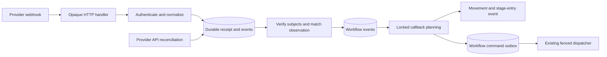

# Workflow stage integrations

Implementation branch: `feat/workflow-stage-integrations`, created from freshly
fetched `main` at `058aeaef258c7452e43dc6625e52d01df74d6ab8` on 2026-11-11.
Worktree: `.worktrees/workflow-stage-integrations`. The original temporary
worktree was recovered from edit records after host cleanup on 2026-11-12.

User behavior and setup: [guide](../guides/workflow-stage-integrations.md).
Verification below distinguishes deterministic tests, real PostgreSQL and live
provider/runtime qualification.

## Ownership and contracts

| Owner | Responsibility |
| --- | --- |
| `internal/server/workflowstageintegration` | Connection/catalog administration, generic ingestion, subject observations, action matching and reconciliation scheduling |
| `internal/adapters/integrations/workflowstageintegration/providers/github` | GitHub schemas, signatures, notification mapping, PR verification, review/head/merge conditions and API reads |
| `internal/server/workflow/model` | Integration trigger descriptors, built-in callbacks and structural rule validation |
| `internal/server/workflowautomation` | Pure callback planning, atomic effect intents and existing fenced execution delivery |
| `internal/adapters/postgres` | Scoped references, locks, durable receipts/observations, semantic deduplication, admission, effects and retry guards |
| HTTP server / React UI | Provider-neutral transport and configuration/status presentation |
| `cmd/server` | Explicit provider/service/worker construction and coordinated shutdown |

Every adapter implements `WorkflowStageIntegration`: provider identity,
configuration/action schemas and validation, authenticated `HandleCallback`, and
I/O-free `Matches`. `SubjectProvider` supplies API verification and reconciliation;
`SubjectMatcher` supplies aggregate conditions. GitHub SDK types stay in adapters.
Provider calls never run inside workflow database transactions.

Provider actions and workflow callbacks differ. `review_added` and `pr_merged`
are GitHub actions. `move_task` and `call_agent` are built-in platform callbacks;
they are persisted descriptors, not serialized functions, arbitrary scripts or
outbound callback URLs. A binding chooses exactly one callback.

## Generic webhook API

```text
POST /callbacks/workflow-stage-integrations/{connectionID}
```

The route is outside browser OIDC. The stored connection selects its provider;
headers, query parameters and payload IDs cannot select another adapter/workspace.
The handler depends on the ingestion use case, reads bounded original bytes and
headers, and returns standard responses. It does not decode provider payloads,
read GitHub header names, authenticate signatures or execute workflow effects.

`HandleCallback(context.Context, CallbackInput)` authenticates before trusting the
notification and returns `CallbackResult`: delivery ID, normalized provider events
and authenticated-ignore status. The generic service persists accepted receipts
and events before returning. The adapter receives transient private configuration
and secret values; ordinary response models never contain those values.

Supported receipts return `202`; duplicate/authenticated ignored requests return
`200`. Invalid authentication returns `401`, malformed authenticated input `400`,
unknown/disabled connection `404`, oversize input `413`, and persistence outage
`503`. Configuration races can return `409`, requiring a fresh verified delivery.
Provider-specific handshake protocols beyond normal success require a deliberate
contract extension; GitHub ping is an authenticated ignore.

Adding another provider requires an adapter and composition registration, with no
new route or provider switch in the handler/engine. Fake-adapter tests exercise
opaque raw bytes and different authentication-header schemes.

## Configuration and authorization

Workspace connections contain provider/configuration, coding integration reference,
registered repository allowlist, encrypted write-only webhook secret, version and
configuring administrator. Coding API credentials and webhook secrets are distinct.
Connection provider/coding identity is immutable; secret omission preserves it.

Workflow rules add an integration trigger (`connectionId`, `actionId`, typed
`parameters`) and one callback. Move uses `targetStageId`; call uses `promptText`
and `sessionPolicy`. Existing internal-event rules and legacy command JSON retain
their meaning. One enabled rule per source-stage/connection/action is allowed;
multiple connection/action pairs are independent. SQL enforces scoped connection
references and matching uniqueness. Provider validation rejects unsupported actions,
unknown parameters and missing named artifact inputs.

Workspace admins/inherited organization administrators manage connections, rules,
prompts and explicit retry. Read operations retain normal workspace access. GitHub
senders never supply Orkest authority: effects are attributed to the workflow
configuring administrator and recheck current access. Viewers cannot mutate or
retry. The user explicitly authorized configured agent calls for this feature;
this is an opt-in exception to manual starts, not a general execution-policy change.
Integration callbacks may target any stage, including the source or closed
stage. Targeting the source stage is acknowledged without moving the task;
targeting the closed stage closes it. A closed task cannot be reopened by an
integration callback.

## Artifact observations and external identity

A named stage artifact input selects `code_review` artifacts or compatible
`pull_request` artifacts. Select current revisions from the newest matching
producing stage entry, independently of starting a consumer agent. Verify PR URLs
against the known provider API, immutable base repository and PR IDs. Require both
task-selected registered repositories and connection allowlist membership. Forks
use the base repository identity. Do not fetch arbitrary artifact URLs or trust
user-supplied metadata/title/branch names as ownership.

An observation pins artifact revision IDs and canonical subjects to connection
version, workflow version, binding and consuming task stage-entry version.
Producer and consumer stage versions are different identities. Initial missing or
unavailable inputs remain unresolved; late publication can activate them. Once
pinned, revisions/identities cannot be replaced silently; current verified head and
merge state can be refreshed without repinning.

The first successful verification records activation and a baseline. Events before
activation do not trigger callbacks. Activation is asynchronous: there is no claim
that a webhook arriving before initial verification will trigger. Re-entry and
configuration changes create new observations/baselines. Configuration saves never
execute historical activity or send agent prompts. Empty PR sets cannot satisfy all.

GitHub review actions mean `pull_request_review` / `submitted`, with selected review
states and optional current-head filtering. Comments/requests/edits/dismissals are
not submitted-review events. Merge actions require `pull_request` / `closed` with
`merged == true`. Approval is not a branch-protection gate. `all` merge aggregation
is the default, with explicit `any` support; a new eligible merge is needed even
when some members were merged before activation.

## Durable event and command flow



- Receipt uniqueness is scoped by connection/delivery ID. Semantic review/merge
  identities converge webhooks and reconciliation. External workflow IDs include
  observation/binding/event identity; the task/stage/type-only `StageEvent` identity
  would incorrectly collapse multiple reviews and is not used for external events.
- Verify provider state outside locks. Admission revalidates connection, workflow,
  stage and observation versions. Short transactions atomically admit events and
  semantic-effect identity. All-merge effects fire at most once per observation.
- Event processing rechecks current configuration, authority and active work, then
  commits movement/outbox effects and acknowledgement together. Stale, busy or
  unauthorized effects expose diagnostics without poisoning unrelated tasks.
- Movement uses existing assignment and stage-entry semantics. It never releases
  execution ownership. Entry automation can run separately after the move.
- Agent callbacks snapshot the custom prompt plus bounded structured event context,
  expected assignment and integration configuration identity in a stable command.
  Review bodies are excluded; external context is labeled untrusted data.
- The existing claim/acceptance/run-reservation/prompt-outbox path delivers commands.
  Run reservation additionally locks and rechecks workflow/connection configuration,
  administrator authority, task assignment, conversation and stage version. Disable,
  edits or reassignment between admission and reservation cannot authorize a launch.
- Waiting/active/uncertain work blocks callbacks, preserving ownership and approvals.
  Eligible blocked events require explicit retry. Ordinary failed/uncertain execution
  commands are not blindly reset or automatically retried; acceptance reconciliation
  takes precedence. See [delivery ownership](workflow-delivery.md).

GitHub does not automatically redeliver failed webhooks. Periodic read-side
reconciliation uses successful cursors and an overlap window, producing the same
semantic events as receipts. API failures/rate limits remain visible. A dismissed
or deleted transient event may not be reconstructible from current API state;
this feature does not claim complete historical external auditing. See GitHub's
[event](https://docs.github.com/en/webhooks/webhook-events-and-payloads),
[signature](https://docs.github.com/en/webhooks/using-webhooks/validating-webhook-deliveries)
and [failure-handling](https://docs.github.com/en/webhooks/using-webhooks/handling-failed-webhook-deliveries)
documentation.

## Session compatibility

`continue_or_create_if_absent` restores only a compatible conversation belonging
to the current assigned agent. New platform sessions persist optional
`agentDefinitionId` metadata. A saved session with different or missing identity
fails visibly for an integration continuation, preserving its state; no inferred
identity or silent fresh replacement is allowed. `new` is an explicit alternative.
Legacy manual continuation retains its original behavior, including pinned models.

Trace: `WorkflowExecutionService` → `TaskDispatcher.StartTask` →
`continueTaskSession` / `createTaskSession` → `ReserveSessionRun` → existing
launch and prompt delivery. Existing runtime/worker wire formats remain unchanged.
Session errors become sanitized `session_incompatible` delivery diagnostics.
Deterministic tests round-trip persisted session configuration and send a follow-up;
real credentialed runtime continuation is a separate qualification requirement.

## Migrations and deployment

0042 adds connections, receipts, normalized events, observations and admissions.
0043 extends existing rule/event fields and indexes. Regenerate sqlc from SQL and
frontend SDK/validators from OpenAPI. Scoped foreign keys prevent cross-workspace
or dangling connection selection. Keep replay-protection identities while active
observations can receive redelivery.

Stop old platform workers before deploying matching platform/UI builds; old code
cannot interpret new event/rule kinds. Independent agentctl processes continue.
Validate new connections before enabling them. Before rollback, stop ingestion,
reconcile commands, export relevant history/configuration and honor down-migration
guards. See [operations](../operations/migrations.md).

## Verification record — 2026-11-12

- `make check` passed: Go lint and tests, runtime/architecture boundaries,
  generated API consistency, frontend lint, 89 Vitest tests, type checks and
  production builds.
- `make sqlc` and `make fmt` passed. `git diff --check` passed.
- Focused GitHub provider and HTTP API tests passed. Deterministic orchestration,
  workflow and session guard tests are included in `make check`.
- PostgreSQL integration tests were not run: this environment has no configured
  `DATABASE_URL`/`POSTGRES_*` credentials or running project database. Run
  `make db-up` with local settings, then `make test-postgres` before deployment.

Live GitHub notifications/private repositories and credentialed pinned OpenCode
restore/follow-up are not verified: required live model/provider settings and an
OpenCode executable are unavailable. Fixture/local-infrastructure evidence must
not be presented as live qualification. Existing team-member capacity and transport
security limitations in [status](../status.md) remain outside this feature.
