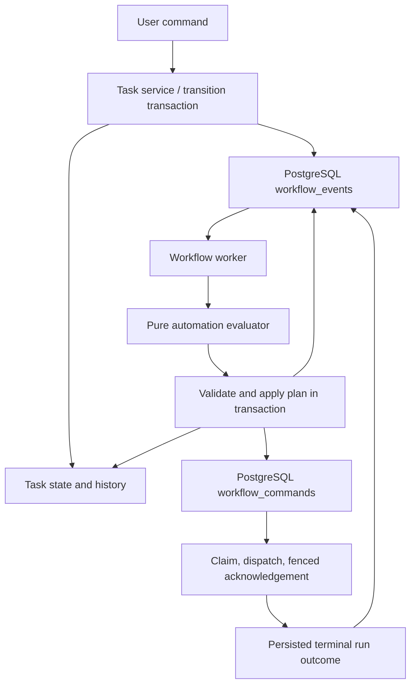

# Workflow implementation

User behavior: [workflows](../guides/workflows.md).

## Event propagation and recovery

Event transaction:

- Creation, source/user/automation movement persist stage-entry events with task changes.
  Terminal runs atomically record normalized success/failure; manual completion has its own event.
- Events are internal: no publishing API or broker. Idle polling: one second, then drain.
- Event selection with `FOR UPDATE SKIP LOCKED`, latest-configuration reads, task locks, evaluation,
  movement/start enqueueing, and acknowledgement share one transaction; no external execution.
- Movement records another entry event; entry automation is asynchronous. API/UI expose
  `automationPending` separately from execution health.

Movement and delivery:

- User movement returns after commit. Missing assignment/prerequisites produce visible
  failed work when automation runs, without undoing movement.
- Queued/active work conflicts with movement/reassignment. An explicit start accepted
  before entry-event handling supersedes automatic start. No movement rule means stay put.
- At-least-once delivery uses stable event IDs; effects/acknowledgement commit together.
  Stage-entry versions reject stale entries; run IDs reject obsolete same-stage completions.
  Acknowledge obsolete events without effects.
- Record configuration version, matched rule (if any), occurrence time, causation,
  and correlation. Configuration saves emit no events or retroactive starts.
- Durable delivery claims reconcile stable prompt IDs. Reserve runs before
  external launch; uncertain accepted starts enter recovery, never blind replacement.
- Recheck actor mutation access at dispatch. Imports use the administrator who last
  saved configuration. Ordinary failures require user retry.
- Shutdown cancels/joins platform workers, preserving independent agentctl processes
  and pending approvals. External dispatch holds no database connection or transaction.
  Durable claims fence run reservation and acknowledgement; see [delivery ownership](workflow-delivery.md).

## Architecture and extension boundaries

| Owner | Responsibility |
| --- | --- |
| `internal/server/workflow` / `WorkflowConfigurationService` | Definitions, stages, rules, structural validation |
| `internal/server/task` / `TaskService` | CRUD, comments, repositories, imported-content protection |
| `internal/server/workflowautomation` / `WorkflowAutomationService` | Movement/evaluation; implements task-owned `TaskWorkflowPlanner` for combined updates |
| `WorkflowExecutionService` | Access, stage-version, accepted-command checks; orchestration dispatch; delivery/work-state effects |
| `WorkflowAutomationWorker` | Scheduling only |

- Task/workflow never import automation; `cmd/server` wires their ports. Workflow also never imports task.
- Configuration save/delete validates service policy against locked versions, agents,
  occupied stages, and task/integration references; database constraints remain final guards.
- Task creation selects initial stage/assignment under workflow lock, committing task/entry
  event together. Import policy retains local state or supplies explicit source-closure destination to SQL.
- Execution-health reads retain task/run locks until returned effects commit.
- Creation, updates, transitions, events, and execution commands have separate repository
  contracts/adapters. Updates/transitions share latest-workflow/task locking and an I/O-free service callback.
- Compare replays before effects; commit task, history, events, command intent atomically.
  Imported-content/execution-conflict policy stays in services. Package layout does not
  change persisted command JSON or API shapes. Delivery claim metadata is added by
  migration 0038; see [upgrade and rollback](../operations/migrations.md#workflow-delivery-claims).
- [Artifact snapshots](artifacts.md) commit with reservation; [stage bindings](../guides/artifacts.md) define inputs.
- The trigger adapter verifies/deduplicates notifications, resolves explicit resource links to workspace
  tasks, and persists normalized events. Future provider conditions/matchers belong in that adapter.
  PR ingestion is now implemented by [task trigger integrations](../guides/task-trigger-integrations.md); output gates and scripts remain deferred.
- Returning to In progress and starting revisions are separate; entry rules decide execution.

## Verification

See [testing](testing.md) and [migrations](../operations/migrations.md).

## Complete effects and delivery

Domain planners construct stage versions, event identities/causation, command
identities and options, history, replay acceptance and work states. Optional
command identities are generated before entering the transaction, so locked
planning remains deterministic and performs no identity-generation I/O. Repositories
retain locks, SQL constraints, conditional writes and affected-row checks. Event
acknowledgements and their task/outbox effects commit together. A failed outbox
insert rolls back prior event inserts and task movement.

Start delivery commits a token/deadline in a short transaction; the use case
performs external dispatch and acknowledges through another short, fenced
transaction. Run reservation validates the claim before atomically writing the
session/run and prompt intent. A superseded claimant cannot reserve or acknowledge.
Expired claims reconcile existing acceptance only. Unaccepted uncertain attempts
become visibly failed with `delivery_uncertain`, requiring explicit user retry;
no existing run/process ownership is released by expiry. See migration 0038's
[upgrade constraints](../operations/migrations.md#workflow-delivery-claims).
