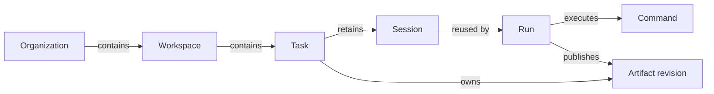

# Domain glossary

| Term | Meaning |
| --- | --- |
| Organization | Membership and administration boundary containing workspaces. |
| Workspace | Project boundary for repositories, tasks, configuration, and credentials. |
| Task | A unit of work on a configured workflow board. |
| Workflow / stage | A board and one of its named positions. Position is separate from execution health. |
| Agent definition | Reusable instructions, runtime/model settings, skills, MCP selections, and permission policy. |
| Team member | Planned execution capacity using an agent definition. Each member supplies one slot; allocation is unfinished. |
| Runtime | The coding program agentctl runs, such as OpenCode or Codex ACP. |
| Model provider / model | The model service and selected model identifier, separate from the runtime. |
| Runtime profile | Workspace preset for runtime, model, and provider environment settings. |
| Execution profile | Workspace toolchain image paired with a runtime. |
| Executor | Environment lifecycle implementation: Docker or trusted Local processes. |
| agentctl | Independent worker owning the runtime subprocess, ACP connection, and journal. |
| Session | Durable conversation and compatible runtime configuration; several runs can reuse it. |
| Run | One work step with its own execution identity and outcome. Infrastructure recovery retains that identity. |
| Command | Idempotent operation, such as a prompt, identified by a stable command ID. |
| Delivery claim | Temporary permission to reconcile or deliver one workflow command. Its token fences reservation and acknowledgement; expiry proves no execution termination. |
| Execution ownership | Durable reservation and runtime/process ownership retained until the step ends and ownership is resolved. Separate from a delivery claim and from team-member capacity. |
| Artifact / revision | Task output and an immutable version of its content or external reference. |
| Coding integration | Repository discovery and Git credentials for a coding provider. |
| Task integration | Source task import and synchronization, independent of coding credentials. |
| MCP | HTTP tool connection used by a runtime, including Orkest's built-in tools. |
| ACP | Stdio protocol between agentctl and the coding runtime. |

Direct conversations belong to a workspace and have sessions and runs without a task.
