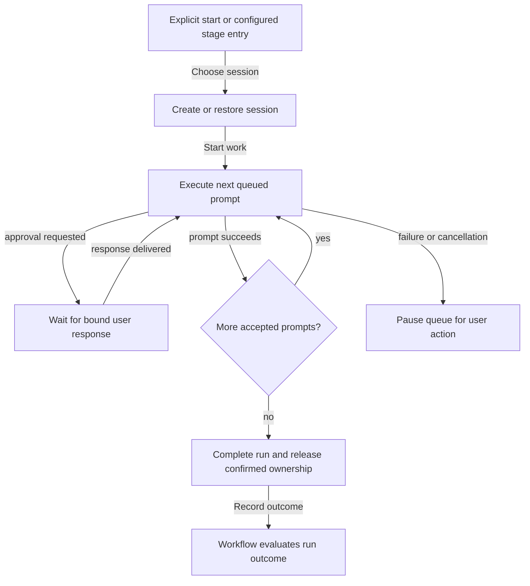

# Durable task sessions

- One current conversation per task; older sessions may remain.
- One work step per run; sessions span runs. Infrastructure recovery retains run ID.
- Assignment never starts work; configured [entry rules](workflows.md) can.
- Direct workspace/agent conversations share task-chat history, replay, approvals,
  cancellation, and queues. Creation starts the runtime; first user message is its
  first prompt. No task, task-context prompt, or workflow change.

## Interaction flow

## Start and iterate

- History enables **Continue session** (default) / **New session**.
- Composer stays visible after completion. Follow-ups start runs as needed, even
  before status refresh; no start dialog. Composer can explicitly choose a fresh session.
- Done tasks/Viewers are read-only.

| Choice | Configuration | Retained work |
| --- | --- | --- |
| Continue session | Original agent, runtime, provider/model, instructions, skills, permissions, and MCP endpoints | Saved conversation, working trees, untracked files, task branches |
| New session | Current assigned agent configuration | Previous chat history, working trees, untracked files, task branches |

- Re-resolve MCP headers by server ID; apply [environment continuation rules](agent-configuration.md#environment-and-session-changes).
- Incompatibility fails visibly, retaining state; no silent model/conversation substitution.

## Queue and completion

- Follow-ups queue durably FIFO during work/approvals. Acceptance means stored, not completed.
- Queue drain ends the run; success rules move stages (seeded board: review).
- Failure/cancellation pauses pending prompts.
- **Resume queue** continues remaining prompts without silently resending interrupted work.
- **Discard queued prompts** ends failed work without review movement. Blocked restore
  requires confirmed environment termination before another run.

## Recovery

- Platform shutdown leaves workers running. Restore compatible state/known queues where safe.
- Missing replay evidence, tool activity, pending approvals, or uncertain effects
  pause interrupted work for reconciliation. Cancellation stays paused; failed restore is interrupted/blocked.
- Loading alone proves no interrupted-work continuation. Retain files/state; never
  delete locks/creation markers to force replacement.

References: [storage/recovery](../operations/storage-and-secrets.md), [runtime limits](../reference/runtimes/README.md),
[status](../status.md), [worker API](../reference/agentctl-api.md),
[platform API](../../internal/app/httpapi/openapi.yaml), [session internals](../development/sessions.md),
[testing](../development/testing.md).
