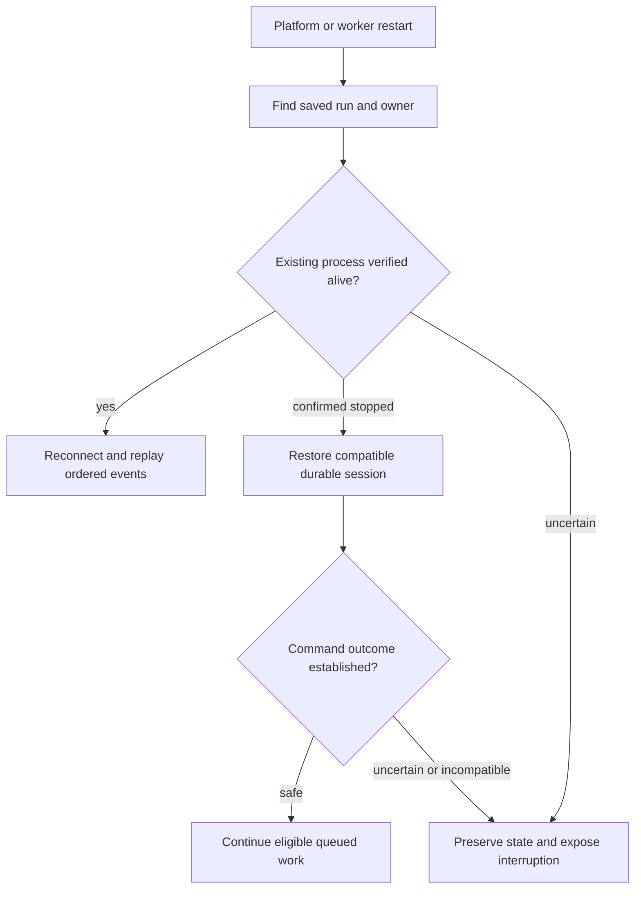

# Storage and secrets

Recovery requires surviving database/task storage; complete host/disk loss is outside MVP.

## Retain together

| Data | Location or setting | Why it matters |
| --- | --- | --- |
| Product state, run identities, prompt outbox | PostgreSQL | Reconciles commands and prevents duplicate work |
| Workspace files and management checkouts | `ORKEST_DATA_DIR/<organizationID>/<workspaceID>/` | Retains workspace-managed files |
| Docker task work and runtime state | `ORKEST_DATA_DIR/tasks/<scope-hash>/` | Mounted as `/workspace` and `/agentctl-state` |
| Local task work and state | `ORKEST_DATA_DIR/agent-executions/` | Retains host execution state |
| Integration encryption key | `ORKEST_INTEGRATION_ENCRYPTION_KEY` | Decrypts credentials and environment/session snapshots |
| Agent MCP signing key | Override or `ORKEST_DATA_DIR/agent-mcp-token.key` | Verifies run-scoped tool credentials |
| Built profile images | Configured registry | Later runs need their recorded image digests |

- Default root: `./data`. Bind paths must be daemon-visible, including under Compose.
- Retain working trees, untracked files, branches, runtime homes, manifests,
  checkpoints, journals. Restore at the same paths with compatible pinned runtimes.

## Protect credentials

- Integration key: `ORKEST_INTEGRATION_ENCRYPTION_KEY`, 32 bytes encoded as 64 hex
  characters. Encrypts coding/task credentials, workspace secrets, MCP headers,
  provider settings, execution snapshots.
- Keep it outside PostgreSQL in deployment secret management. Loss/replacement makes
  saved values unreadable; no automatic rotation/re-encryption migration is documented.
- Separate MCP signing key: `ORKEST_AGENT_MCP_TOKEN_KEY` overrides persisted key.
  Tool tokens expire after 24 hours, binding user/organization/workspace/task and applicable run.
- `ORKEST_AGENT_MCP_URL` must be execution-reachable; Compose: `http://orkest:8080`.
- Treat runtime state as secret: checkpoints may contain MCP headers despite excluding
  Git PATs. Never commit/export as artifacts.
- Codex auth copies refresh independently without updating the host source.

## Restart and diagnose

- Missing heartbeat proves no termination. Never delete markers, locks, journals,
  or manifests to force replacement.
- Check saved identity, endpoint, version, paths, sanitized compatibility diagnostics.
  Reconcile uncertain external results before retry; cancellation stays paused;
  approvals are never automatic.
- Back up database, keys, files, runtime state, and retained images together.
  Verify restore with a follow-up message, not loading alone.
- Backup schedules/recovery objectives remain open.

## Operator administration

After first login, database operators grant global skill administration with
`UPDATE users SET platform_admin = true WHERE id = '<internal-user-id>';`;
set `false` to revoke. Organization/workspace membership stays separate.

- Request correlation: `trace_id` / `X-Trace-ID`; no tracing SDK/exporter.
- Ordinary logs exclude raw runtime output and secrets.

See [sessions](../guides/sessions.md), [migrations](migrations.md), [testing](../development/testing.md).
