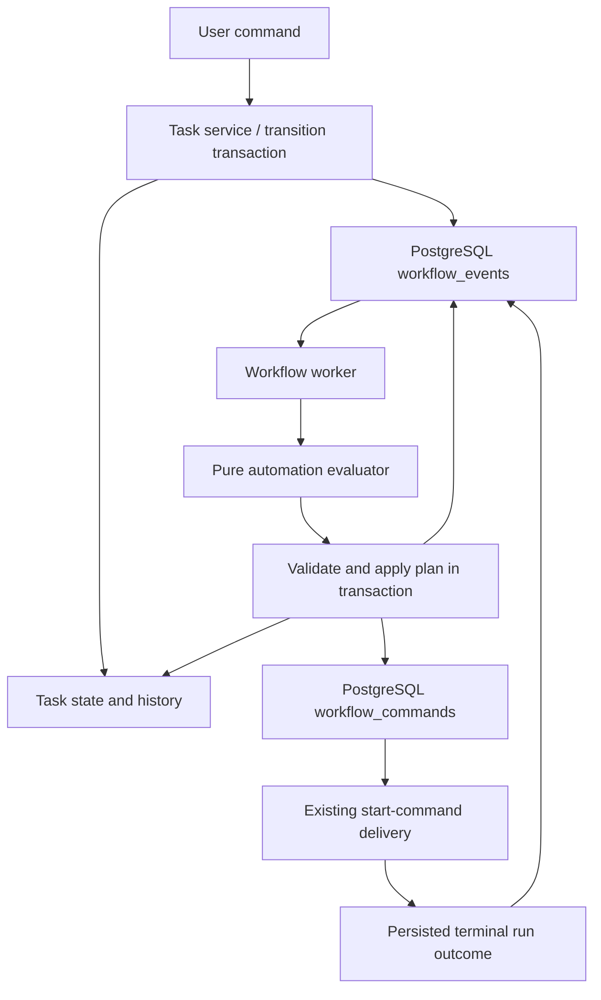

# Workspace workflows

Workflows are task boards with ordered stages and explicit automation rules.
Every task and source integration selects a workspace workflow. Stage IDs are
stable keys; task `status` contains that key for API compatibility. Display order
does not determine movement, initial state, or closure. A definition has 1–50
stages, an `initialStageId`, a `closedStageId`, and up to 200 rules.

## Configuration and behavior

Workspace admins and inherited organization owners/admins configure workflows.
Members may transition tasks; viewers cannot mutate tasks, start executions,
complete stages, configure rules, or answer runtime approvals.

Stages contain a name, description and optional responsible agent. Entering a
stage applies that assignment, retaining the current assignment when unspecified.
The name and description describe the agent's current work scope in its prompt.
New tasks enter the explicit initial stage; source closure moves directly to the
explicit closed stage. Closed tasks cannot reopen. Reordering columns has no
behavioral effects. Changing the explicit closed stage changes which tasks are
considered closed. Referenced stages, workflows and agents cannot be deleted.
A workspace must retain at least one workflow.

Automation rules contain a stable ID, enabled flag, event, source stage, action
and optional target stage. The initial supported combinations are:

| Event | Action | Destination |
| --- | --- | --- |
| `stage_entered` | `start_work` | Current task/stage |
| `run_succeeded` | `move_task` | Explicit different stage |
| `stage_completed` | `move_task` | Explicit different stage |

At most one enabled rule may match an event and source stage. Closed stages
cannot have outgoing automation. Stage-entry rules cannot move tasks, preventing
movement loops. There is no expression language or arbitrary action execution.
Manual completion and successful execution have independent rules. Failed runs,
cancellation and interaction waits never advance or retry automatically.

The seeded board contains Todo, In progress, In review and Done. Entry into In
progress starts assigned work. Successful execution or manual completion there
moves to In review. Custom stages have no automation by default. Explicit starts
remain available independently of stage movement and create another work step.
Automation always starts a new runtime session; explicit starts may select
`continue` or `new` and supply a prompt.

## Event propagation and recovery

Task creation, source-driven stage changes, user movement and automation movement
persist stage-entry events in the same transaction as the task change. Terminal
run persistence atomically records a normalized success/failure event. Manual
completion records its own event. Events are internal; no event publishing API or
broker is introduced.

The worker polls once per second when idle and drains available work. Events use
`FOR UPDATE SKIP LOCKED`. Claim, latest-configuration read, task locking, rule
evaluation, resulting task movement/start enqueueing and event acknowledgement
occur in one transaction. No external execution happens in this transaction.
Moving to a destination records another stage-entry event; its entry automation
runs asynchronously. Task responses expose `automationPending`, and the task UI
shows pending automation separately from execution state.

User movement returns after its stage change commits. Missing assignment or other
unavailable entry execution prerequisites produce a visible failed work indicator
when automation is processed; they do not undo an already committed movement.
Task movement/reassignment conflict with queued or active execution. An explicit
start accepted before an entry event is handled supersedes that automatic start.
A completed stage with no movement rule stays in place.

Delivery is at least once. Stable event IDs deduplicate stage entries and run
outcomes; event acknowledgement commits atomically with effects. Stage-entry
versions fence obsolete events, and run IDs fence old completion events from
retries in the same stage. Obsolete events are acknowledged without effects.
Every handled event records the configuration version and matched rule, if any.
Event rows also retain occurrence time, causation and correlation identifiers.
Configuration saves never emit events or retroactively start work.

Start commands retain the existing exclusive delivery lock and reconciliation
against the stable prompt command identity. Reservation persists a run before
external launch. Accepted but uncertain starts belong to launch recovery and are
never blindly replaced. Execution delivery rechecks the actor's current mutation
access. Imports act on behalf of the administrator who last saved configuration.
Ordinary execution failures require user retry. Platform shutdown cancels/joins
its worker without stopping independent agentctl processes or approving requests.
The worker holds a database connection through command dispatch; lease-based
claims remain a possible throughput improvement, not part of this change.

## Architecture and extension boundaries

`internal/workflow` owns definitions, stages, rule configuration and structural
validation through `WorkflowConfigurationService`. It never imports task or
automation services. Configuration saves and deletions validate service-owned
policy against locked snapshots of versions, registered agents, occupied stages
and task/integration references. Database constraints remain the final guard.

`internal/task` owns task CRUD, comments, repository links and imported-content
protection through `TaskService`. Creation selects the configured initial stage
and assignment under the workflow lock, then persists the task and entry event
atomically. Source synchronization uses task-owned import policy to retain local
state or apply source closure; SQL receives the explicit destination.

`internal/workflowautomation` owns stage movement, rule evaluation and start
coordination. `WorkflowAutomationService` implements the task-owned
`TaskWorkflowPlanner` interface for stage-change requests within combined updates.
`WorkflowExecutionService` rechecks access, stage versions and accepted command
identities before dispatching through orchestration. It returns explicit delivery
and work-state effects. Execution health reads retain task/run locks until those
effects commit. `WorkflowAutomationWorker` only schedules these services.
Neither task nor workflow imports automation; app constructs and connects them.

Task creation, task updates, stage transitions, automation events and execution
commands have separate repository contracts and PostgreSQL adapters. Task updates
and explicit transitions share data-access code that locks the latest workflow
and task and invokes a supplied service callback. The callback performs no I/O.
Replay comparison precedes new effects, and task changes, history, events and
command intent commit atomically. Imported-content decisions and execution
conflicts stay in services. Persisted command JSON and public API payloads retain
their existing shapes. This package refactor changes queries and generated code
without changing the database schema.

Task artifacts belong to tasks and survive stage movement. Stages can declare
named outputs and input bindings to outputs of another stage. Dispatch snapshots
matching revisions and stores input identities atomically with run reservation;
missing required inputs prevent consumer startup. Output declarations do not gate
producer completion. See [task artifacts](task-artifacts.md).

A future integration adapter can verify/deduplicate a PR notification, resolve its
linked artifact to a workspace task, and persist a normalized event.
Provider-specific conditions and matchers should be added with that adapter.
PR event ingestion, producer output gates and configurable scripts remain future
work. In particular, returning to In progress and starting revisions are separate
actions; the destination entry rule determines whether execution follows.

## API and UI

- Workflow CRUD remains under workspace-scoped `/workflows` endpoints.
- Definitions expose stages, explicit initial/closed references and `rules`.
- `POST .../tasks/{taskID}/transitions` accepts `move`, `start`, or `complete`,
  with `stageVersion` and `commandId`; optional execution options apply to starts.
- Legacy task PUT uses the same task locking and planner and preserves content.
- Configuration saves require the last-read workflow version. Movement and event
  evaluation use the latest configuration under the same workflow row lock.
- The editor provides initial/closed stage selectors, entry start toggles, and
  separate explicit destinations after run success and manual completion.

## Migrations and verification

0035 establishes the branch's relational workflows from main-branch v34.
0036 converts its booleans into rules with explicit destinations, pins existing
initial/closed stages, and migrates pending run outcomes into the durable event
inbox. Queued starts retain their identities. Existing tasks, working files,
sessions and agent processes are preserved. Deploy platform writers and workers
together; the old workflow API/configuration shape is replaced.

0036 rollback deletes event audit history and approximates explicit rules using
legacy booleans. Nonadjacent destinations and separate manual-completion policies
cannot be preserved. Back up configuration and drain events/stop workers before
rollback. The superseded branch migrations 0035–0039 still require the local reset
described in [local rollback commands](local-workflow-migration-reset.md) before
adopting the rewritten 0035; do not relabel Goose records without resetting schema.

Verify with `make check`, `make test-postgres` with local database settings, and
race detection for workflow, task, orchestration and PostgreSQL tests. Runtime
provider execution and live multi-stage continuation require configured runtimes
and credentials; deterministic event delivery does not qualify those behaviors.
